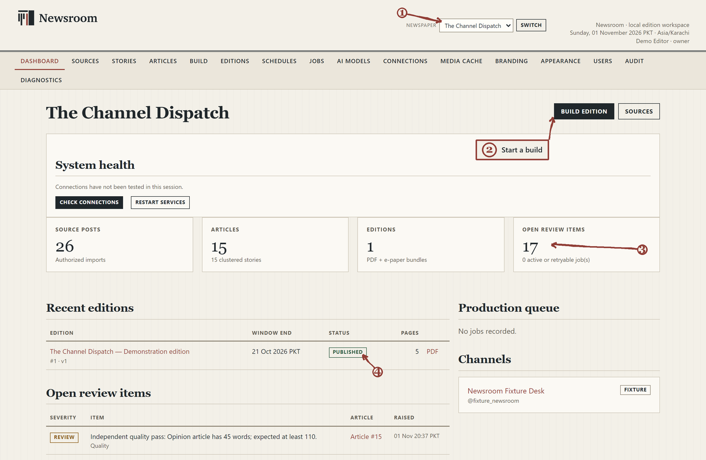
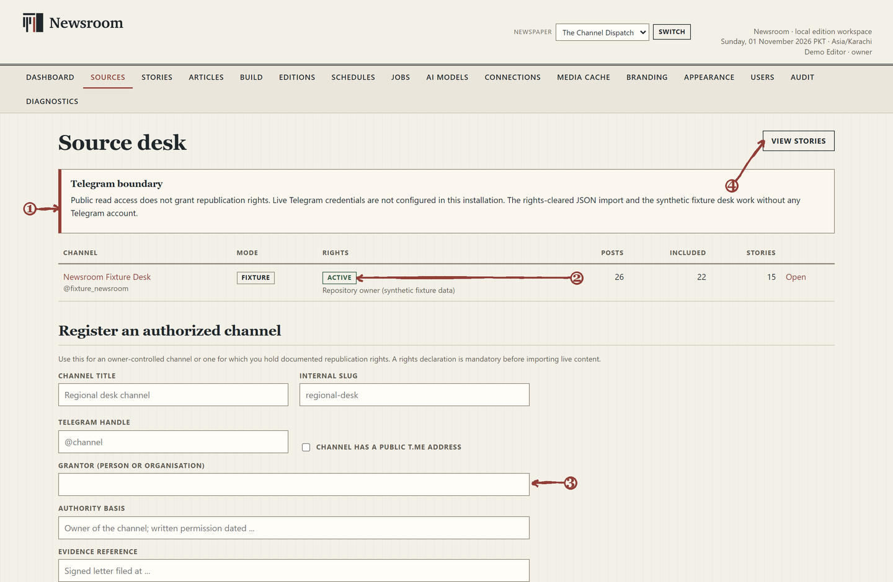
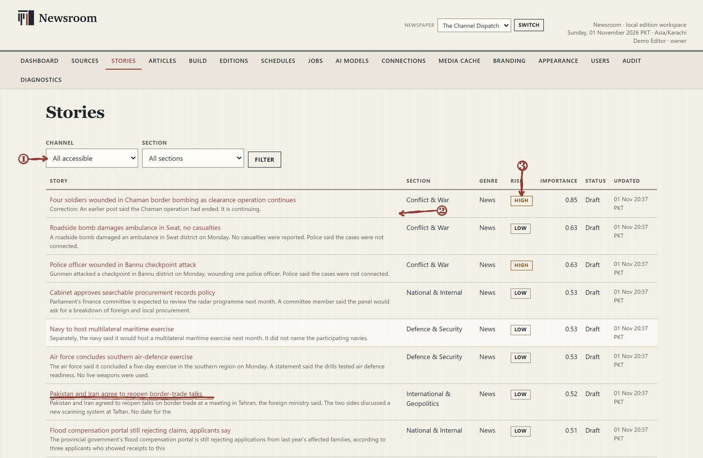
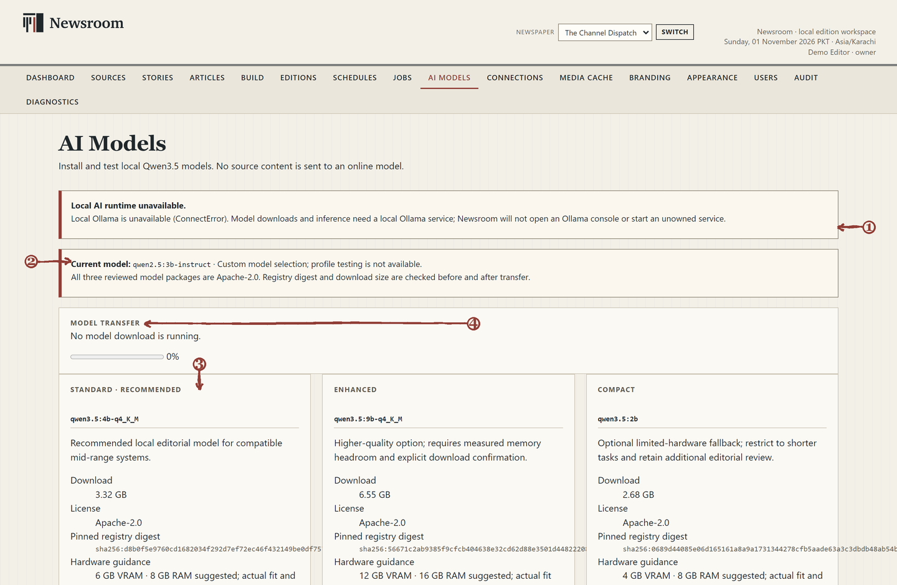
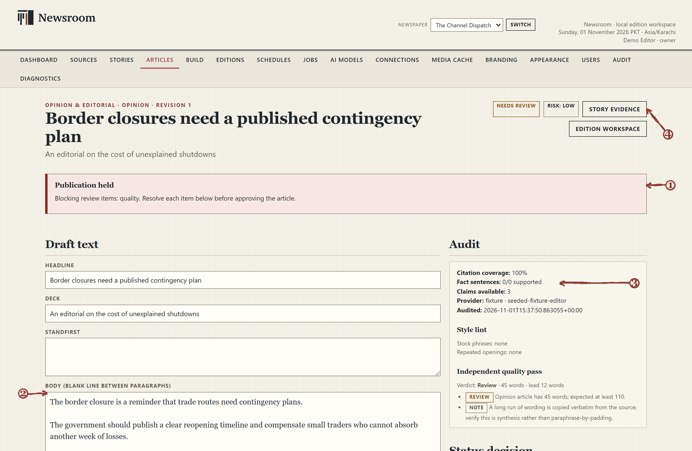
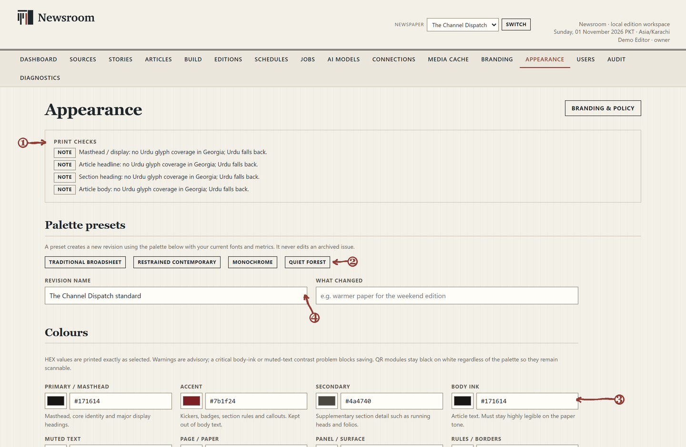
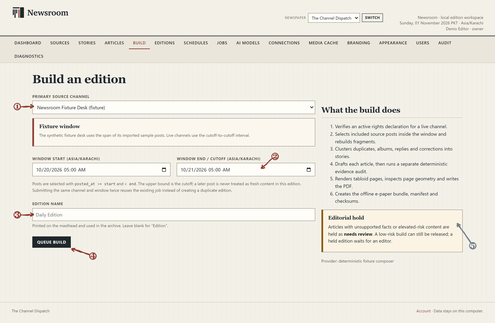
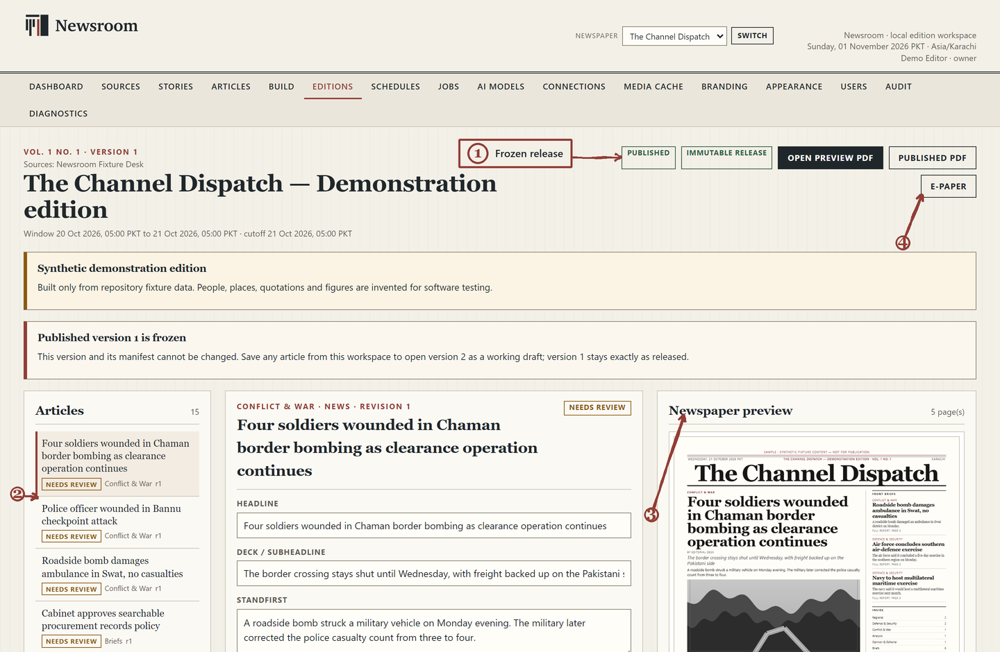
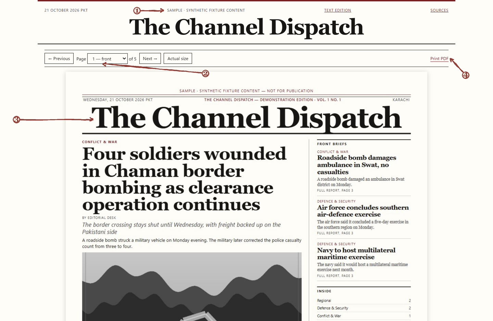

  <a href="assets/brand/newsroom/newsroom-logo-horizontal.svg">
    <picture>
      <source media="(prefers-color-scheme: dark)" srcset="assets/brand/newsroom/newsroom-logo-reversed.svg">
      
    </picture>
  </a>

<em>Many sources. One edition.</em>

# Newsroom

Newsroom is a local-first Windows newsroom and newspaper publishing application. It brings authorized source material, editorial review, page design and printable editions into one desktop workspace, so a publisher can take a story from a source post to a finished paper without assembling a chain of separate tools.

The database, source media, drafts and published editions stay on the computer. The finished issue leaves as an 11 × 17 inch tabloid PDF and an offline e-paper bundle that opens in a browser.

**Windows 10 or Windows 11, 64-bit · Newsroom 1.0**

*The dashboard for a synthetic demonstration newspaper. The same screen shows production totals, the current review queue and the latest edition.*

1. Choose the newspaper you are working on. Sources, drafts and editions follow this selector.
2. Start a new edition, or open **Sources** to add material.
3. See how many items are waiting for an editor.
4. A released issue shows its status, page count and PDF link.

## What Newsroom does

**One desk, several newspapers.** Each newspaper on the computer keeps its own name, masthead, source list, schedules, drafts, archive and editor access. The selector in the header switches the working paper without mixing one publication's material into another.

**From an authorized source to a supported story.** Newsroom imports rights-cleared Telegram Desktop JSON or an owner-format export. It separates greetings, promotions and link-only posts from reportable material, then groups duplicate reports, albums, replies and corrections into one story. Every draft is tied to a claim ledger, a chronology and the source posts behind it, so an editor can see what a sentence is based on.

**Drafting with a local model, when you choose to use one.** The **AI Models** page manages the optional local Qwen3.5 models that run through Ollama on the same computer. Drafts are checked against the story's claims before they can move forward, and the editor remains responsible for the published text. Newsroom does not send source text to a hosted AI service.

**A newspaper, not a web page styled as one.** The build produces a real tabloid PDF with a front page, multi-column interiors, continuation lines, source codes, embedded fonts and measured page fill. Alongside the PDF, Newsroom writes an offline e-paper bundle with the same pages and a searchable text edition.

**A different look for every paper.** **Appearance** gives each newspaper its own palette, type roles, print metrics and specimen proofs. A released edition pins the exact theme and font files it was printed with, so later design changes do not alter an archived issue.

**Work that keeps its place.** Builds run as local jobs with a visible stage, progress and retry history. Editions are numbered and versioned; a published issue is frozen, while a new working draft can be opened from it. **Schedules** record recurring windows and can be run on demand. Unattended runs need a Windows task or worker that you configure; the installer does not create one.

## An illustrated tour

The screens below come from Newsroom's synthetic demonstration profile. No live channel, personal account or unpublished news is shown.

### Start with an authorized source

*Source desk. The source list, its rights declaration and the registration form sit on one page.*

1. The boundary notice explains why public read access is not the same as permission to republish.
2. Every source carries a mode, a rights status and the person or organization that granted permission.
3. Record the grantor, authority basis and evidence reference before importing live content.
4. Open the stories produced by this source.

### Turn posts into stories

*Stories. Reports are grouped, classified and rated before anyone writes a headline.*

1. Filter the desk by source and section.
2. Corrections stay attached to the story they change, instead of replacing the record.
3. Risk, importance and draft status are visible before an editor opens the story.

### Choose a local drafting model

*AI Models. Local drafting is optional; the page reports the state of the model runtime honestly.*

1. If Ollama is not reachable, Newsroom says so instead of falling back to a remote service.
2. The current model selection is shown with its status.
3. Standard, Enhanced and Compact profiles cover different hardware and quality needs.
4. Model transfers and readiness are reported before a draft can use them.

### Review the article, not just the text

*Article review. A held article names the blocking item and keeps the evidence beside the draft.*

1. A held article explains what must be resolved before it can be approved.
2. Headline, deck, standfirst and body are edited in place, with revision history behind them.
3. The audit panel reports citation coverage, supported claims and independent quality checks.
4. **Story evidence** opens the claim ledger, chronology and source posts behind the draft.

### Give each newspaper its own look

*Appearance. Print checks, palette presets and exact colour values belong to one newspaper.*

1. Print checks flag missing glyph coverage before a page is built.
2. A preset creates a new theme revision without changing an issue already in the archive.
3. Colours are entered as exact HEX values, with contrast and ink warnings.
4. Each revision is named and its change recorded, so the print identity has a history.

### Set the edition window and queue the build

*Build. The window, the source and the edition name are set before the job enters the queue.*

1. Choose the source channel for this edition.
2. Set the exact start, end and cutoff. A later post is never treated as fresh content inside an earlier window.
3. Name the edition; the name appears on the masthead and in the archive.
4. Queue the build. The job continues in the local worker while the window is open.
5. High-risk or unsupported material is held for an editor instead of being released automatically.

### Read the edition before release

*Edition workspace. The release state, article list, review controls and print preview share one screen.*

1. A published version is frozen, with its manifest and checksums fixed.
2. Select an article to review; held items are marked in the list.
3. The preview uses the real page layout, not a mock-up.
4. Open the offline e-paper or the published PDF from the same toolbar.

### Publish a paper people can read offline

*E-paper. The released issue opens as a complete offline edition, page by page.*

1. The e-paper marks synthetic demonstration content clearly.
2. Page navigation and actual-size view work without a network connection.
3. The front page is the same layout used for the PDF.
4. **Print PDF** opens the print-ready issue.

## A short workflow

1. Create the owner account and name the first newspaper.
2. Open **Sources**, add a channel you are authorized to use, and record its rights declaration.
3. Import a rights-cleared export, then review the grouped reports under **Stories**.
4. If you use local AI, install a model on **AI Models** and draft from a story.
5. Resolve held items under **Articles**; edit the text and check the evidence panel.
6. Set the paper's palette and type on **Appearance**, then choose the window on **Build**.
7. Preview the PDF and e-paper under **Editions**, release the issue, and keep the published version as the archive record.

## Installation and first use

Newsroom runs on Windows 10 or Windows 11, 64-bit. The supplied distribution includes `NewsroomSetup.exe` under `dist\installer`. The installer is per-user and normally needs no administrator account. It installs the application under `%LOCALAPPDATA%\Programs\Newsroom` and can add a desktop shortcut.

Microsoft Edge WebView2 Runtime is required. If it is missing, the installer runs Microsoft's signed bootstrapper, which needs an internet connection. Allow about 1 GB for the application, plus space for editions, media and any local models.

On first run:

1. Create the owner account and keep the password safe. There is no email-based password reset.
2. Name the newspaper and set its masthead and publication details.
3. Add an authorized source under **Sources** and record the rights declaration.
4. Import a rights-cleared export, or use the synthetic demonstration channel to practise the workflow.
5. Build a first edition, read the preview, then release it when the content is ready.

Local AI is a separate installation. Newsroom does not bundle Ollama or model weights. Install Ollama on the same PC if you want local drafting, then use **AI Models** to download and prepare a supported Qwen3.5 model. The import, editing, PDF and e-paper workflow does not need a model.

The full instructions are in the product documentation:

- [Quick Start](docs/user/01-QUICK-START.md) — install, first run and a first edition.
- [User Manual](docs/user/02-USER-MANUAL.md) — every screen and control.
- [Editorial & Publishing Guide](docs/user/03-EDITORIAL-AND-PUBLISHING-GUIDE.md) — review, release and corrections.
- [Installation & Maintenance](docs/user/04-INSTALLATION-AND-MAINTENANCE.md) — updates, backup and recovery.
- [Troubleshooting & FAQ](docs/user/05-TROUBLESHOOTING-AND-FAQ.md) — symptoms and safe steps.
- [Documentation index](docs/user/00-DOCUMENTATION-INDEX.md) — the complete manual set, including PDFs.

## Privacy, data and product scope

Newsroom is designed around a local desk. The installed application keeps its database, media cache, drafts and editions under `%LOCALAPPDATA%\ChannelPress`, with published editions in the `output` folder inside it. Editing, previewing and reading an existing edition work without a network connection.

A connection is used when you choose a feature that needs one: Telegram sign-in or collection when Telegram API credentials are configured, external story research when you enable a provider, the WebView2 bootstrap during installation, or a model download from the Ollama registry. Local drafting uses Ollama on the same computer; it does not send source text to a hosted AI service.

Source rights and editorial judgement remain with the publisher. Permission to read a channel is not permission to republish it, and every live source should have a recorded rights declaration. Newsroom helps keep the evidence and review record, but it does not decide whether a story is safe or lawful to publish.

The Newsroom name and Folio Mark identify the software. They do not replace a customer newspaper's masthead, and they are not inserted into the newspaper's own pages.

## Documentation and rights

Start with the [documentation index](docs/user/00-DOCUMENTATION-INDEX.md) or the [Quick Start](docs/user/01-QUICK-START.md).

Newsroom is proprietary software. All rights reserved. No permission to redistribute, modify, publish, or create derivative works is granted. See [LICENSE](LICENSE). Third-party components remain under their own licenses; see [THIRD_PARTY_NOTICES.md](THIRD_PARTY_NOTICES.md).
