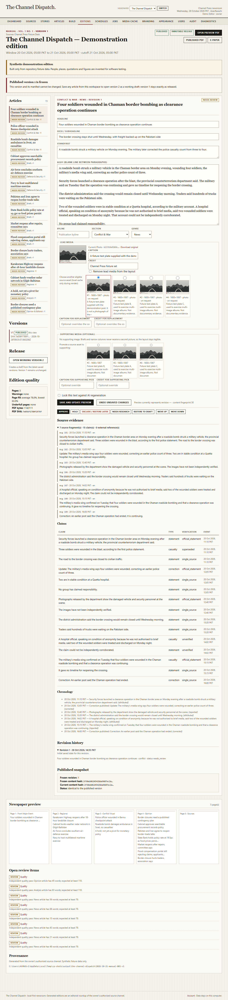
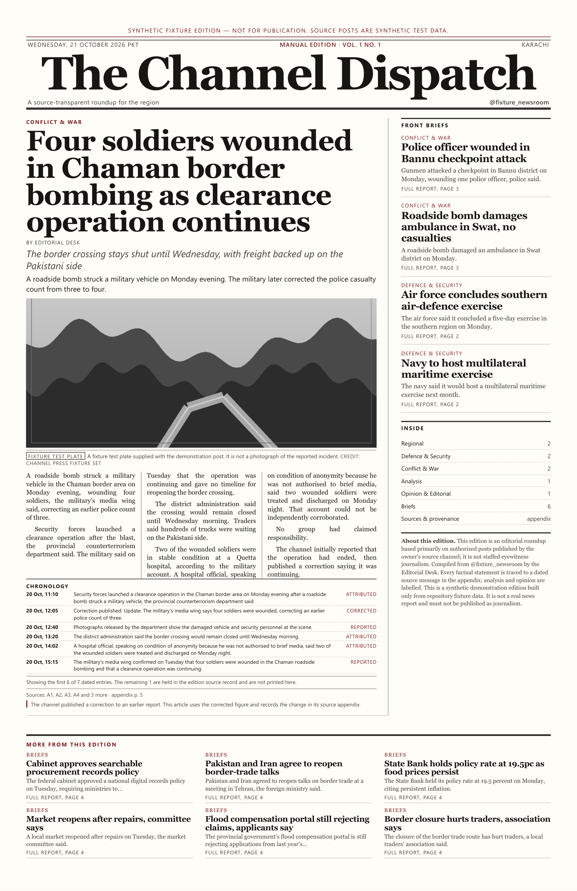

# Channel Press

Channel Press turns an owner-authorized Telegram channel into a printable local
newspaper and an offline e-paper edition. It runs on a single Windows laptop,
keeps source evidence next to every sentence, and produces a real 11 × 17 inch
tabloid PDF rather than a web page styled as a newspaper.

The repository ships with a complete, credential-free demonstration built from
synthetic fixtures. Nothing in the demo pretends to be live Telegram reporting.


## What is implemented

- **Authorized intake.** Owner import of Telegram Desktop JSON or the owner-format
  export, albums, edits, replies, deletions and rights withdrawal. A live MTProto
  user-session adapter performs the local login, resolves `@handle` to a stable
  channel id, and collects an exact cutoff window with checkpointed resume. Live
  login and retrieval still need the owner's Telegram API values and consent; see
  [Live Telegram setup](#live-telegram-setup-owner-only) and
  [Limitations](#limitations).
- **Moderation and source languages.** Every post is classified before drafting:
  greetings, emoji, promotions, link-only reposts and number-only posts are
  excluded with a persisted reason, while short casualty, correction and emergency
  alerts are retained. English, Urdu script, Roman Urdu and mixed Urdu/English are
  detected separately. Profanity is detected in plain and obfuscated forms, but a
  report that quotes abuse is not discarded; threats and targeted abuse are routed
  to review. An editor decision survives re-imports and classifier upgrades. Before
  clustering, the pipeline reclassifies stored posts written by an older ruleset and
  creates missing fragments for newly includable posts; `classify-posts` exposes the
  same backfill on the command line.
- **Institutional attribution.** The publication is identified as the source, never
  as an individual reporter or eyewitness. The byline and source disclosure are
  configurable, and the attribution scan flags invented scene reporting, staff
  correspondents and fabricated journalist identities before release.
- **Media lifecycle.** Relevant, rights-cleared source media is downloaded in a
  bounded pre-layout stage with retry and size limits. Layout and PDF rendering use
  local files only and never call Telegram. Downloads stay for drafts, review,
  failed or interrupted editions and are removed only after a verified publication;
  provenance, checksums, rights links and source records are retained.
- **Story memory.** Post splitting, duplicate clustering, reply linking,
  correction reconciliation, a claim ledger with chronology and a separate
  deterministic evidence audit.
- **Editorial drafting.** Version-controlled prompt templates, a deterministic
  fixture composer for reproducible tests, and an optional local Ollama provider.
  Every draft is audited against the claim ledger before it can be released.
- **Media and graphics.** Source-linked photos, reversible derivatives,
  OpenCV video frames, collages with credits, sourced charts, chronological
  timelines and locator maps from bundled Natural Earth data.
- **Print engine.** Paged.js pagination rendered through installed Chrome, a
  distinct tabloid front page, 3–4 column interiors, continuation labels, source
  records, a source appendix, embedded fonts, measured per-page fill and
  automated overflow/blank-page/orphan-head checks.
- **Per-newspaper appearance.** Each paper carries an immutable, revisioned print
  identity: nine palette colours with HEX controls and presets, seven type roles,
  print metrics, contrast/ink warnings and real specimen proofs. Fonts come from
  installed families or validated `.ttf`/`.otf`/`.ttc` imports kept in a managed
  library. A released edition pins the exact theme and bundled font files it was
  printed with, and the e-paper uses the same palette and typography.
- **Newsroom UI.** Source desk, rights declarations, stories, article editing and
  review, edition page studio, schedules, jobs, branding, appearance, users, audit
  and diagnostics.
- **Multiple newspapers on one computer.** Each publication keeps its own
  branding, source list, schedules, drafts, editions, archive and editor
  membership. The header selector switches the working newspaper; the server
  enforces access on every page and edition download.
- **Multiple authorized sources per newspaper.** Priority and weighting decide
  which report leads a shared story; each edition can include every enabled
  source or one channel only. Duplicate reports are folded into one attributed
  story, and a per-source collection failure leaves a clearly marked partial
  edition rather than silently dropping that source.
- **Scheduling and publication.** Deterministic job keys, exact
  `[previous cutoff, current cutoff)` windows, watermark catch-up, leases and a
  single-worker file lock, atomic release, manifest and checksums, immutable
  numbered versions and a fully offline e-paper bundle.
- **Verified local AI.** The pipeline ran a real Ollama model
  (`qwen2.5:3b-instruct`) over a 30-post fixture set: 17 stories, 17 articles,
  8 tabloid pages, no fixture fallback, peak VRAM 2213 MiB.



## Requirements

- Windows 10/11, Python 3.12.
- Google Chrome installed (the PDF pipeline launches the installed Chrome
  channel through Playwright). No cloud account or paid API is required.
- Optional: Ollama with a local instruct model for non-fixture drafting.
- No FFmpeg is required; OpenCV supplies video frame extraction.

## Install

```powershell
git clone <repository> E:\newsroom
cd E:\newsroom
powershell -ExecutionPolicy Bypass -File .\scripts\install.ps1
```

The script creates `.venv`, installs pinned dependencies, copies `.env.example`
to `.env` if needed, checks for Chrome and initialises the SQLite database.

## Five-minute demo

```powershell
# 1. Import the synthetic fixtures and build a complete edition.
.\.venv\Scripts\python.exe -m channel_press.cli demo --posts sample --reset

# 2. Start the newsroom UI.
.\.venv\Scripts\python.exe -m channel_press.cli serve
```

Open <http://127.0.0.1:8765>. If no owner exists yet, `demo` creates one and
prints a generated password once. Use `set-password` to choose a new one:

```powershell
.\.venv\Scripts\python.exe -m channel_press.cli set-password --username owner
```

The build writes a real edition to:

```text
output\the-channel-dispatch\2026-10-21-manual-001-v1\
  sample_issue.pdf      5-page, 11 × 17 in, searchable PDF
  print.html            print composition
  edition.html          same composition for browser review
  pages\page-01..05.png page proofs
  epaper\index.html     offline e-paper viewer
  epaper\text.html      text edition and source appendix
  manifest.json         version, page geometry, hashes and provenance
  checksums.json        SHA-256 for the bundle files
```



Open `epaper\index.html` directly from disk to confirm the offline bundle works
without the server. The in-app viewer lives at `/editions/1/epaper/`.

## Live Telegram setup (owner only)

The application never asks for credentials in chat and never stores a login code
or two-step password. `.env` is untracked and already contains empty
placeholders; only the owner fills it in.

1. Register a Telegram application at <https://my.telegram.org> and edit `.env`:

   ```text
   CHANNEL_PRESS_TELEGRAM_API_ID=<your numeric app id>
   CHANNEL_PRESS_TELEGRAM_API_HASH=<your app hash>
   CHANNEL_PRESS_TELEGRAM_SESSION_PATH=./data/telegram.session
   ```

2. Install the optional adapter and restart the server:

   ```powershell
   .\.venv\Scripts\python.exe -m pip install -e ".[telegram]"
   .\.venv\Scripts\python.exe -m channel_press.cli serve
   ```

3. In **Sources**, register the channel and record a rights declaration covering
   **Ingest**, **AI processing** and **Publication** for the scopes you actually
   hold. API access alone is not permission to republish.
4. Open the channel's **Telegram connection** page. Save the `@handle`, select
   **Test source connection**, then request a login code with the account that may
   read the channel. Enter the code and any two-step password only in that local
   form.
5. Use **Import last 30 days (context only)** for story memory. It is labelled
   `context` and never enters the next daily edition.
6. Create a daily schedule, then check the **Effective window** card: start is
   inclusive, end is exclusive. A post at exactly the cutoff belongs to the next
   issue. Use **Sync window** to store the posts without building.
7. Build from **Build** with **Collect this window from Telegram before building**
   ticked, or let the Windows task do it at the cutoff.

`diagnostics` and the **Diagnostics** page report configured / missing /
session-present states without printing any secret value.

## Everyday commands

| Task | Command |
| --- | --- |
| Initialise or migrate the database | `python -m channel_press.cli init-db` |
| Create the first owner | `python -m channel_press.cli setup --demo-channel` |
| Build a demo edition | `python -m channel_press.cli demo --posts sample --reset` |
| Capacity fixtures | `python -m channel_press.cli demo --posts 30` (also `70`, `150`) |
| Import an authorized export | `python -m channel_press.cli import --channel <slug> --file <export.json> --media-root <folder>` |
| Build the latest window now | `python -m channel_press.cli run-now --channel <slug>` |
| Run one worker pass | `python -m channel_press.cli worker --once` |
| Inspect media cache (no deletion) | `python -m channel_press.cli media-cache --dry-run` |
| Clear unused media cache | `python -m channel_press.cli media-cache --clear-unused --confirm` |
| Retry cleanup for one published edition | `python -m channel_press.cli media-cache --finalize-edition <id>` |
| Start the UI | `python -m channel_press.cli serve` |
| Check an edition | `python -m channel_press.cli check-edition --edition-id 1` |
| Back up | `python -m channel_press.cli backup` |
| Restore (app stopped) | `python -m channel_press.cli restore --archive <zip>` |
| Environment report | `python -m channel_press.cli diagnostics` |
| Health (configured vs tested) | `python -m channel_press.operations health` |
| Start the complete local desk | `powershell -ExecutionPolicy Bypass -File .\scripts\start.ps1` |
| Graceful stop | `powershell -ExecutionPolicy Bypass -File .\scripts\stop-services.ps1` |
| Controlled restart | `powershell -ExecutionPolicy Bypass -File .\scripts\restart-services.ps1` |

All Python commands use `.\.venv\Scripts\python.exe` on Windows.

### Media cache and source retention

`data/media` holds downloaded source files and generated derivatives. The
**Media cache** page and `media-cache` command remove local files only; source
posts, media rows, captions, credits, checksums, rights links and audit events
remain. Both default to a dry run and require explicit confirmation before
deletion.

Protected files are never removed: anything used by a draft, awaiting-review,
failed or running edition; media under an editor lock; media referenced by an
active job; files inside the configured `media_retention_hours` window; and the
working media of a published edition whose PDF or e-paper bundle is incomplete.
After a verified publication, the edition's downloaded working media is removed
automatically. A cleanup failure is recorded as `pending` and can be retried with
`media-cache --finalize-edition <id>`; it never reverses a successful release.
Owner-supplied imported files are treated as a source library and are only
removed by an explicit cache command.

Two helper scripts cover the automation path:

```powershell
powershell -ExecutionPolicy Bypass -File .\scripts\install-task.ps1   # worker every 15 min
powershell -ExecutionPolicy Bypass -File .\scripts\uninstall-task.ps1
```

The task calls `run-worker.ps1`, which performs one short-lived worker pass and
exits. No model or server process stays resident while the desk is idle.

For normal interactive use, run `scripts\start.ps1`. It validates the
configuration and database, stops an old managed instance, starts the web
service detached, launches one background worker pass to recover queued or
stale jobs, waits for the login page to answer, and opens the local URL in
Google Chrome. Use `scripts\stop-services.ps1` when finished; it requests a
cooperative stop and waits for the web service or in-flight worker operation
to release its resources. The startup worker is intentionally one-shot: local
models are not kept loaded while the desk is idle.

`stop-services.ps1` requests a graceful stop and waits; it never kills unrelated
processes. `restart-services.ps1` validates configuration and the database, stops
what is managed, resumes, checks the local model, starts the web app detached and
polls it until it answers. `service-health.ps1 -Validate -Probe` adds a bounded,
read-only Telegram check. See `docs/CONCURRENCY_RECOVERY_REPORT.md` for verified
results and `TROUBLESHOOTING.md` for failures.

### Concurrency and live safety

- One SQLite writer, short transactions. Network, model, media and PDF work never
  run inside an open write transaction; a transient `database is locked` is
  retried with backoff and then reported as a friendly `503`, never a raw `500`.
- One Telegram session owner. The web app and the worker share a serialised
  gateway with a cross-process lease on the `.session` file; rendering a page never
  contacts Telegram.
- One collector per channel/window. An edition that finds its window already being
  collected waits (`waiting_for_collector`) instead of failing or duplicating it.
- Queue Build performs a bounded, read-only Telegram preflight when live collection
  is requested and refuses to queue a job with a concrete reason if it fails.
  Fixture and manual-import builds need no Telegram connection.

## How it works

```text
authorized export / fixture
        |
   ingestion  ->  normalization, exclusion reasons, versions, media
        |
   story      ->  fragments, clusters, claims, corrections, timeline
        |
   editorial  ->  ranking, review gates, article state
        |
   ai         ->  fixture or Ollama draft -> independent evidence audit
        |
   media/graphics -> photos, frames, charts, timelines, maps
        |
   layout     ->  plan pages -> Paged.js + Chrome -> PDF -> geometry QA
        |
   publishing ->  atomic folder + manifest + checksums + e-paper bundle
        |
   scheduling ->  deterministic jobs, watermark, lease, release policy
```

Key modules live under `channel_press/`:

| Package | Responsibility |
| --- | --- |
| `ingestion` | Export formats, normalization, exclusion, media, MTProto adapter |
| `telegram` | Local user-session login, handle resolution, windowed history fetch |
| `collection` | Exact cutoff windows, durable staging, checkpoints, watermark |
| `editorial` | Story clustering, claims, correction, review rules |
| `ai` | Prompt templates, fixture/Ollama providers, audit, style lint |
| `media` | Asset cache, ranking, derivatives, frame extraction |
| `graphics` | Charts, timelines, cartography |
| `layout` | Edition plan, chunking, print HTML, PDF rendering, theme proof, QA |
| `publishing` | Atomic release, manifest, checksums, e-paper |
| `scheduling` | Jobs, watermarks, leases, worker |
| `web` | FastAPI routes, Jinja templates, session/CSRF/role checks |

Theming lives in `channel_press/theming.py` and the managed font library in
`channel_press/fonts.py`.

Data stays under `data/` (SQLite database, media originals and derivatives,
imported fonts, theme proofs, secret key, logs) and `output/` (published
editions). Both are gitignored.

## Print identity and themes

Each newspaper owns its print design rather than sharing a global stylesheet.
The **Appearance** screen edits nine palette colours (masthead, accent, body ink,
paper, rules and so on), seven type roles (masthead, headline, section,
standfirst, body, caption, numbers) and bounded print metrics such as body size
and leading.

- Colours are entered as HEX values or loaded from a named preset. The screen
  reports low-contrast text and paper/ink combinations that would waste ink or
  become unreadable in print.
- Fonts are chosen from families actually installed on the machine, or imported
  as `.ttf`, `.otf` or `.ttc` after file validation and a licence confirmation.
  The app reports missing weights/styles and glyph coverage instead of faking
  bold or silently substituting a face.
- Saving creates a new immutable **theme revision**. A draft uses the current
  revision; a released edition pins the exact revision, palette, font files and
  metrics it rendered with. Editing the theme afterwards never rewrites an
  archived issue.
- **Render specimen proof** produces a real tabloid PNG from the same
  `print.css` and compiled theme CSS used by the PDF, so the preview is not a
  browser approximation. Proofs are cached by theme hash and regenerated when
  the theme changes.
- The PDF, page PNGs, e-paper, charts, maps, captions and QR labels all consume
  the same palette and font stacks. QR modules remain black on white for scan
  reliability.

## Publication truthfulness

- The demonstrated edition is labelled **synthetic fixture edition — not for
  publication** on its front page and in its manifest.
- The printed footer says the paper is an editorial roundup prepared from the
  owner's authorized Telegram source, not independent newsroom reporting.
- Source appendix rows identify fixture messages explicitly. No QR code is printed
  unless a public destination was verified reachable.
- `public_base_url` is empty by default, so no localhost or placeholder QR is
  emitted. The default policy is an honest printed source appendix.

## Security and privacy

- Argon2id password hashing, server-side sessions, CSRF tokens on every mutating
  form, role checks on every route, login throttling and audit logging.
- Secrets live in `data/secret.key` or environment variables; they are never
  rendered into HTML, PDFs, manifests or logs.
- Imported JSON, captions and model output are treated as untrusted data.
  Prompt-injection sentences are detected and neutralised as evidence, not
  followed.
- External URL validation blocks loopback, link-local and private-network
  targets. Source data is not sent to any online service by default.

## Measured performance on the build machine

12th-gen Intel i7, 16 GB RAM, RTX 3060 Laptop GPU (**6144 MiB**), Windows 11,
Chrome installed, Ollama 0.40.9 with `qwen2.5:3b-instruct` (1841 MB).

| Scenario | Result |
| --- | --- |
| Idle web server | ~62 MB working set, 0 CPU seconds over a 10 s sample, 13 threads |
| sample fixture (26 messages), fixture composer | 6.4 s, 15 stories/articles, 5 pages |
| 30-post fixture build | 9.6 s cold CLI run, 17 stories/articles, 7 pages |
| 70-post fixture build | 10.8 s cold CLI run, 27 stories/articles, 8 pages |
| 150-post fixture build | 12.1 s cold CLI run (9.7 s inside the pipeline), 28 stories/articles, 9 pages, ~870 MB peak process group including Chrome |
| 30-post **real Ollama** build | 57–62 s, 17 stories, 17 articles, 8 pages, no fixture fallback, peak VRAM 2213 MiB |
| PDF page size | exactly 792 × 1224 pt (11 × 17 in) on every page |
| GPU | unused for fixture composition and layout; used only while drafting |

The fixture rows were re-measured on 2026-10-27 with a cold data directory, so
they include database creation, fixture import, composition, Chrome rendering
and publication. Page counts depend on the copy: the capacity fixtures repeat a
small number of topics, so their pages end shorter than the sample edition's.
Their manifests report underfull pages as diagnostics and no proof warnings.

These are measurements, not throughput promises. The 30-post real-model run is
the only real-model capacity result; its page count predates the current page
packing. 70- and 150-post real-model runs were not performed. Run `diagnostics`
and one real build before relying on a tight cutoff-to-release window.

## Tests

```powershell
# Fast unit/integration suite
.\.venv\Scripts\python.exe -m pytest -m "not slow" -q

# Full suite, including real PDF renders for sample/30/70/150 fixtures
.\.venv\Scripts\python.exe -m pytest -q

# Lint (dev extra)
.\.venv\Scripts\python.exe -m pip install -e ".[dev]"
.\.venv\Scripts\python.exe -m ruff check .
```

Last recorded run: **277 passed, 2 skipped** in 345 s. The skips are the two
Ollama live tests because no model server was running. The suite renders actual
PDFs, checks exact page geometry, verifies searchable text, inspects every page
proof for blank/overflow defects and confirms the e-paper bundle and checksums.
The moderation/media regression file covers meaningless-post exclusion, English,
Urdu script, Roman Urdu and mixed-language alerts, obfuscated profanity, threats,
institutional attribution, legacy stored-post backfill before clustering,
rights-gated bounded downloads, local-only rendering, cache protection/path
traversal, post-publication cleanup and the protected web and CLI controls.
Collection tests cover window boundaries, pagination resume, duplicate windows,
context backfill and watermark commits.

```powershell
# Real local model proof (needs Ollama running with the configured model)
.\.venv\Scripts\python.exe -m pytest -m live tests\test_ollama_live.py -q

# Live Telegram proof (needs .env values, a completed login and rights)
.\.venv\Scripts\python.exe -m pytest -m live tests\test_telegram_live.py -q
```

## Limitations

- **Live Telegram was not verified in this pass.** The fixture and owner-import
  paths are covered by automated tests. Login, handle resolution, windowed
  collection and resume are implemented, but the real target channel
  (`The Pakistan News`) still requires the owner's Telegram login, content rights
  and a supervised run. No claim in this README treats a fixture result as live
  evidence.
- **Real-model coverage is 30 posts only.** A 70- or 150-post real-model build was
  not run. The deterministic fixture composer remains the fallback and is always
  labelled as such.
- **The real-model audit is strict.** In the 30-post proof, 14 of 17 articles were
  held as **Needs review** because the model introduced contextual proper nouns
  (for example a country the source did not name). That is the intended gate, not
  a silent pass; an editor must clear the flags before release.
- **No public hosting.** E-paper bundles are local folders; the app does not
  promise a public landing page. QR output is disabled unless a reachable public
  URL is configured.
- The demo uses synthetic names, places and figures. They exist to exercise the
  pipeline and must not be quoted as news.
- Maps are locator graphics from public-domain Natural Earth layers, not
  survey-grade or operational products. See `docs/CARTOGRAPHY.md`.

## Documentation

- [User manual](USER_MANUAL.md) — day-to-day editor procedures.
- [Admin guide](ADMIN_GUIDE.md) — users, rights, secrets, models, schedules,
  backup and security.
- [Troubleshooting](TROUBLESHOOTING.md) — recovery procedures.
- [Implementation log](IMPLEMENTATION_LOG.md) — milestone history and test results.
- [QA report](docs/QA_REPORT.md) — acceptance evidence, page inspection and
  measured limits.
- [Post-M14 readiness report](docs/POST_M14_READINESS_REPORT.md) — separate
  `fixture`, `local AI`, `Telegram live` and `scheduled publication` statuses.
- [Cartography](docs/CARTOGRAPHY.md) and [decision records](docs/decisions/).

## Licence and source rights

The application code is provided for the owner's use. Bundled Natural Earth data
is public domain; fonts come from the Windows installation and are embedded for
print. Telegram content is processed only with a recorded rights declaration.
The software does not grant republication rights and must not be used to bypass
Telegram's terms or a channel owner's consent.
