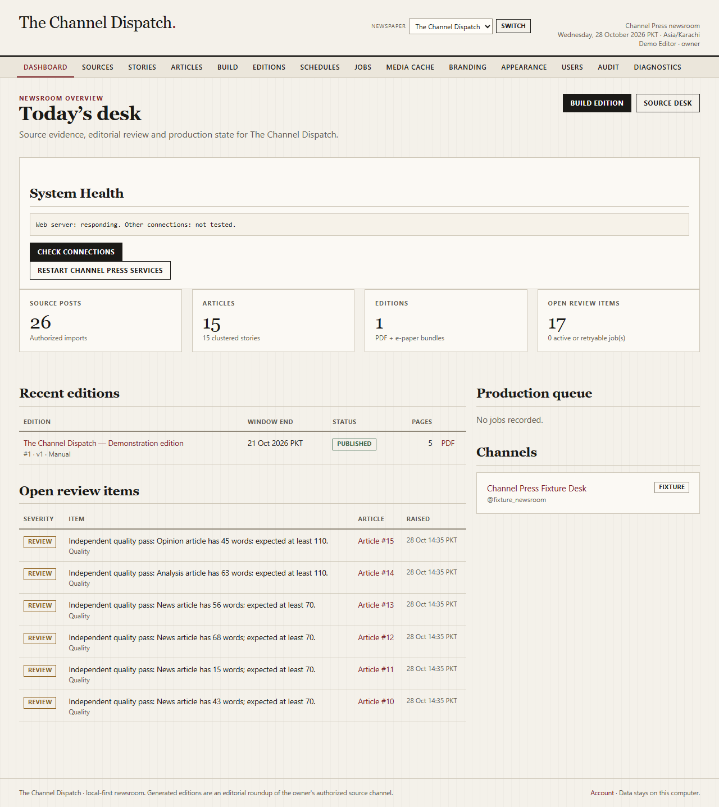
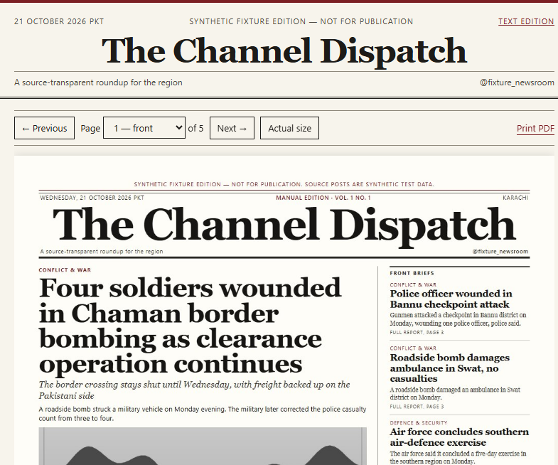
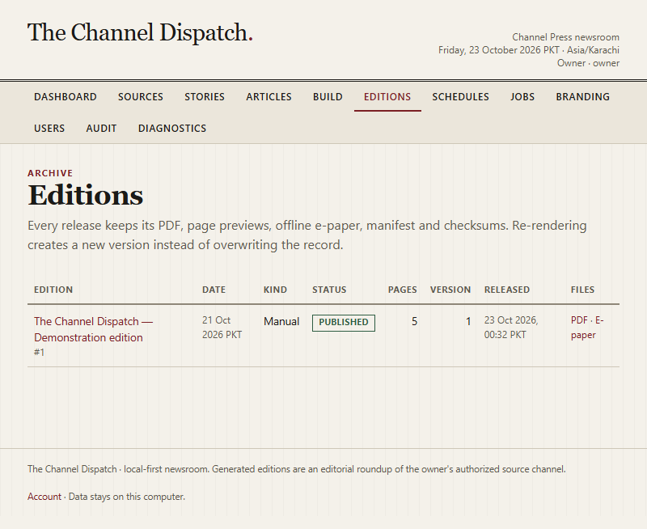

# Channel Press — User Manual

This manual is for the editor who runs the newsroom day to day. It describes the
screens and procedures that exist in this build, using the labels shown in the
interface. Administrative and security procedures are in
[ADMIN_GUIDE.md](ADMIN_GUIDE.md); recovery steps are in
[TROUBLESHOOTING.md](TROUBLESHOOTING.md).

The screenshots come from the synthetic demonstration edition. Names, figures and
places in that edition are test data.

## 1. Starting the newsroom

1. Open PowerShell in the project folder.
2. Start the server:

   ```powershell
   .\.venv\Scripts\python.exe -m channel_press.cli serve
   ```

3. Open <http://127.0.0.1:8765>.
4. Sign in with your username and password.

The header shows the publication name, the current date in the configured
timezone, your display name and role. The navigation is:

**Dashboard · Sources · Stories · Articles · Build · Editions · Schedules · Jobs ·
Branding · Users · Audit · Diagnostics**

Menus you cannot use are hidden or rejected by the server. There is no public
registration screen; accounts are created by an owner.



### If the first-run screen appears

When no owner exists, the app shows **Set up Channel Press**. Enter a username,
display name and a password of at least 12 characters. The first account becomes
the owner. This screen only exists while the user table is empty.

### Signing out

Use **Sign out** in the header. Sessions expire after the configured number of
hours (12 by default).

## 2. The dashboard

Owners see a compact **System Health** card with **Check Connections** and
**Restart Channel Press Services**. *Configured* is not the same as *connected and
tested*: credentials can be present while Telegram is unreachable or not signed in,
and the card says so. **Check Connections** runs a short, read-only check of the
web server, database, Telegram/source channel, worker, Ollama and the configured
model, and lists active jobs with their last error.

**Restart Channel Press Services** asks for confirmation, requests a graceful stop,
keeps every database, session, job and checkpoint, and starts the web app again.
Jobs that were paused can be resumed from **Jobs**. It is not a repair button for
wrong credentials or rights.

**Today's desk** summarises:

- **Source posts** — authorized imports in the database.
- **Articles** — clustered stories with drafts.
- **Editions** — PDF and e-paper bundles produced.
- **Open review items** — flags that still need an editor decision.

**Recent editions** links to the archive. **Production queue** shows active or
retryable jobs. **Channels** lists registered sources with a **FIXTURE** badge for
the synthetic desk. **Open review items** lists each flag with its article and
timestamp.

The two actions at the top are **Build edition** and **Source desk**.

## 3. Authorizing a source channel

Only content the owner has the right to process may enter the newsroom. Public
read access alone is not permission to republish.

1. Open **Sources**.
2. Under **Register an authorized channel**, fill in:
   - **Channel title** — the public name.
   - **Internal slug** — optional; generated if blank.
   - **Telegram handle** — for example `@regionaldesk`.
   - **Channel has a public t.me address** — tick only when true.
   - **Grantor (person or organisation)** — who granted the rights.
   - **Authority basis** — for example “Owner of the channel; written permission
     dated 12 October 2026”.
   - **Evidence reference** — where the signed permission is filed.
3. Select **Register channel**.

The declaration is written to the audit trail. A live channel without an active
grant cannot be imported or built. The fixture desk is exempt because its content
is synthetic.

### Rights declarations

Open the channel from **Sources**. The **Rights declarations** table shows the
grantor, basis, scopes (**Ingest**, **AI processing**, **Publication**), acceptance
date and status.

- Owners can expand **Record a new rights declaration** to add another grant.
- Owners can **Revoke** an active grant with a reason. Revocation immediately
  blocks new imports, AI processing and builds for that channel. Existing
  published editions remain in the archive but are not silently reused.

### Withdrawing an individual post

In the channel's **Source posts** table, choose a reason (**Rights withdrawn**,
**Deleted at source**, **Duplicate**, **Promotion only**) and select **Withdraw**.
The post is excluded from future builds without deleting the evidence record.

### Connecting the live Telegram account

This is a one-time owner setup. The API id and hash are edited in `.env` by the
owner; the login code and two-step password are typed only into the local form
and are never stored.

Before you start:

- the owner has registered an application at <https://my.telegram.org> and filled
  `CHANNEL_PRESS_TELEGRAM_API_ID` and `CHANNEL_PRESS_TELEGRAM_API_HASH` in `.env`;
- `pip install -e ".[telegram]"` has been run and the server restarted;
- an active rights declaration covers **Ingest**, **AI processing** and
  **Publication** for the scopes you hold.

Then:

1. Open **Sources** → the channel → **Open Telegram connection**.
2. In **1 · Source handle**, enter `@username`, `t.me/username` or the full URL and
   select **Save handle**. Tick the public-address box only if the channel really
   has a public username.
3. Select **Test source connection**. The app resolves the mutable username to a
   stable numeric channel id and reports **Signed in: Yes** or a readable error.
4. If no session exists, enter the phone number in international format and
   select **Request login code**. Enter the code Telegram sends. If two-step
   verification is enabled, enter that password on the next form.
5. The **Login stage** card shows the current step and expiry. **Cancel login**
   discards a pending attempt; it does not delete a working session.
6. **Sign out** (inside the collapsed panel) deletes the local session file and
   requires a new login. Do this if the laptop is lost, then revoke the session in
   Telegram as well.

The page never prints the API hash, the session string, the code or the
two-step password. Errors such as an inaccessible username, a revoked session or
a flood wait appear as text on this page.

### Context backfill and the cutoff window

After login, **3 · Cutoff-to-cutoff window** shows:

- **Effective window** — start inclusive, end exclusive, in the publication
  timezone;
- **Committed watermark** — the last cutoff already committed;
- **Stored included posts in window** — counted from this computer's source store.

**Import last 30 days (context only)** fills story memory and is labelled
`context`. It never enters the next daily edition and never moves the watermark.

**Sync window** retrieves and stores exactly the effective window without building
an edition. Source media is fetched only when a build needs it, in a bounded
pre-layout step with size and retry limits. Layout and PDF rendering use local
files only and never contact Telegram.

The **4 · Window and retrieval history** table lists each window with status,
included/excluded/duplicate/reply/album counts and the retrieval checkpoint. A
`no_content` window is a verified empty window: it commits so no source date
silently disappears.

## 4. Importing authorized content

1. Open the channel and find **Import authorized content**.
2. **JSON export** — select a Telegram Desktop JSON export or the owner-format
   export. Maximum 40 MB.
3. **Referenced media files (optional)** — select the image/video files named by
   the export so captions and credits stay attached to the original message.
4. Select **Import**.

The page reports the import in the **Imports** table: file name, kind, time, raw
count, accepted count, excluded count and SHA-256 prefix. Each excluded post shows
its reason in the **Source posts** table, for example a Telegram-native forward or
a promotion-only post.

Import is safe to repeat: message identity is `(channel, message id)`, so a
re-import updates rather than duplicates. Edited posts keep a version history.

The command-line equivalent is:

```powershell
.\.venv\Scripts\python.exe -m channel_press.cli import `
  --channel regional-desk --file .\export.json --media-root .\media --create
```

### What gets excluded, and what is kept

Each source post is classified before story processing. The **Source posts** table
shows the result next to the post, including the persisted reason:

- greetings, prayers and condolences with no event detail;
- emoji-only, symbol-only and number-only posts;
- promotions, channel calls and link-only reposts without commentary;
- empty posts and unsupported media with no usable caption;
- repeated copies of an already accepted post;
- “breaking” or “update” posts that contain no information;
- profanity or abuse with no reportable event.

These exclusions are not silent. The original text, message id, source link,
rights state, media metadata and audit history remain in the database.

Short but meaningful alerts are **not** excluded merely because they are short.
A casualty notice, correction or emergency warning in English, Urdu script, Roman
Urdu or mixed Urdu/English is retained. Unrecognised scripts are retained as
**Unrecognised script — needs language review** rather than dropped.

Profanity is detected in plain and obfuscated forms. A news report that quotes
abuse is kept and flagged; threats, targeted abuse and hateful or dehumanising
language are routed to review. Sexual-violence reporting terms are treated as
sensitive editorial material, not as automatic profanity.

### Editor decisions on a source post

Editors can override the classifier in the **Source posts** table:

- **Include in story processing**
- **Exclude from story processing**
- **Include as context only**
- **Mark as promotional**
- **Mark as profanity/abuse**

Select a decision and choose **Apply decision**. The override is recorded in the
audit log and survives re-imports and later builds. Use it when the classifier is
too strict, not to force a fabricated story through review.

Older posts imported before a classifier update are re-checked automatically before
the next build, so a legacy row cannot bypass the current exclusion rules. An
administrator can run the same pass over the whole channel without starting a build:

```powershell
.\.venv\Scripts\python.exe -m channel_press.cli classify-posts --channel regional-desk
```

Add `--window-start`/`--window-end` to limit the pass, or `--force` to reclassify
rows already at the current classifier version. Editor overrides are always kept.

## 5. Reviewing stories and evidence

**Stories** lists clustered editorial units with section, genre, risk, importance
and status. Importance comes from source content, never views or reactions.

Open a story to see:

- its canonical title and summary;
- the **claim ledger** with each claim's status and provenance;
- the **chronology**, ordered by event time;
- linked source posts and message IDs;
- external references cited by the source;
- correction and contradiction notes.

Use this page when an article's wording looks stronger than its evidence. The
claim ledger is the record to quote in a correction.

## 6. Reviewing and editing an article

Open **Articles**, then an article. The header shows section, genre, revision,
status and risk level. A **Publication held** notice lists blocking review items
when the article cannot be approved.

### Editing

The **Draft text** form contains **Headline**, **Deck**, **Standfirst** and
**Body** (blank line between paragraphs).

- Select **Save revision** to store a new numbered revision with an audit entry.
- Tick **Lock this headline and text against regeneration** when the wording must
  survive future builds. Locked articles are not overwritten by a re-render.
- Select **Re-run independent audit** after substantive edits. The audit compares
  names, places, dates, numbers and quotes with the claim ledger.

### Review items

The **Review items** table lists category, severity, message and status. For an
open item, enter a **Decision note** and choose:

- **Approve item** — accept the item with a recorded reason.
- **Reject item** — reject the claim or the risky framing.

Rejecting does not delete the original source evidence; it records an editorial
decision. A high-risk article still requires an explicit status decision.

### Why a real-model draft may be held

The independent audit compares every name, place, date, number and quotation with
the claim ledger. A local model sometimes adds context the source did not state,
for example naming a country for a city. The audit holds that article as **Needs
review** and lists the unsupported sentence. This is expected behaviour: either
remove the unsupported detail, or approve it with a note only when the source
evidence actually supports it. Do not click through a flag just to publish.

### Status and locking

In **Status decision**, set **Article status** to one of **Draft**, **Needs
review**, **Approved** or **Rejected**, then select **Update status**. Use **Lock
article** / **Unlock article** to protect final copy.

### Audit panel

The right column shows **Citation coverage**, **Fact sentences** supported,
**Claims available**, provider/model, audit time and any fallback reason.
Unsupported sentences and style-lint findings are listed when present. Treat a
low coverage figure as a reason to edit, not as a formality to click through.

### Media

Selected photos, video frames and collages appear with caption, credit and
checksum prefix. Captions identify the source and whether an image is a frame
from a video. Synthetic fixture media is marked as non-documentary test data.

### Byline and source attribution

The printed paper identifies **The Pakistan News** as the publication and source
of the roundup, never as an individual reporter or eyewitness. The byline is a
configurable desk label such as **Editorial Desk**, and the source disclosure says
the edition is an editorial roundup of the owner's authorized Telegram source.
Owner settings are under **Branding**.

The evidence audit flags invented attribution such as “our correspondent
visited the scene”, “a reporter for the publication witnessed”, or a staff byline
that the source did not provide. An attribution flag is a publication blocker:
remove the invented scene detail or correct the sentence rather than approving it
as if it were observed reporting.

## 7. Building an edition

Open **Build**.

1. Choose the **Source channel**. The **Next scheduled window** card shows the
   window that the current schedule would use; **Open Telegram collection** goes
   to the connection page.
2. Set **Window start** and **Window end / cutoff** in the publication timezone.
   Posts are selected with `posted_at >= start` and `< end`. A post published at
   exactly the cutoff belongs to the next normal issue, not this one. A late
   worker start never moves the cutoff.
3. Tick **Collect this window from Telegram before building** to fetch the exact
   window first. Leave it unchecked to build only from posts already stored.
   Collection failure leaves the watermark where it was; it does not skip a date.
4. Choose **Edition kind**: **Manual edition** or **Special edition**. A manual or
   special edition does not advance the daily watermark unless it is the
   scheduled daily window.
5. Optionally enter an **Edition title**.
6. Select **Queue build**.

The build creates a persistent job and starts a detached one-shot worker. You can
close the browser; the job continues. **Jobs** shows progress, and the job page
polls its status automatically.

The build performs, in order:

1. verifies an active rights declaration for a live channel;
2. selects included posts in the window and rebuilds fragments;
3. clusters duplicates, albums, replies and corrections into stories;
4. drafts articles and runs the independent evidence audit;
5. ranks media and renders charts, timelines and locator maps;
6. composes tabloid pages, inspects geometry and writes the PDF;
7. writes the offline e-paper bundle, manifest and checksums.

Articles with unsupported facts or elevated-risk content are held as **Needs
review**. A clean, low-risk build can be released automatically when the schedule
allows it; a held edition waits for an editor.

### Capacity

The fixture sets are also capacity tests: `demo --posts 30`, `70` and `150`. If a
large window takes longer than the gap between cutoff and release, the honest
response is to move the cutoff earlier or reduce the window, not to publish late
and call it on time.

## 8. Reviewing a built edition

Open **Editions**, then the edition. The page shows:

- status, issue number, volume and version;
- **Pages** thumbnails with page numbers and layout family;
- **Release** actions;
- **Bundle** file status and PDF hash/bytes;
- **Articles in this edition** with section, genre, status and word count;
- **Provenance**, **Notes** and **Quality inspection**;
- **Open review items**.

### Page studio

Select a page thumbnail to open the full proof. The proof is a raster of the
actual PDF page. Use it to check:

- no clipped headlines, captions or folios;
- no overlapping columns;
- no blank trailing page;
- readable minimum type at physical size;
- source appendix present when the policy requires it.

### Releasing

- **Release edition** marks the local bundle as published. It does not upload to a
  public host. The server checks open review items and the PDF before allowing
  release.
- **Re-render as version 2** creates a new numbered version from the same article
  set. The older version remains in the archive and is not overwritten.

A published edition with open review items displays **Published with open review
items** with the recorded reason. This is deliberate transparency, not a silent
failure.

### Quality inspection

The panel reports page count, paper size, print-proof status and warnings. The
per-page table lists paper size, text characters, images, links, minimum font
size and whether the page is blank. Any unexplained warning is a defect to fix
before release, not a cosmetic detail.

## 9. Reading and printing the edition

From the edition page:

- **Open PDF** — the searchable tabloid PDF.
- **E-paper** — the offline viewer.
- The **Bundle** panel marks **Print HTML**, **E-paper** and **Manifest** as
  available. The print composition is `print.html` and the manifest is
  `manifest.json` inside the edition folder; open either from disk for inspection.

The PDF is exactly 11 × 17 inches (792 × 1224 pt) for the tabloid profile. Print
with “Actual size” or 100% scaling and disable “fit to page”; the margins are part
of the design.

### E-paper viewer



The viewer shows the page image, **Previous** / **Next**, a page selector,
**Actual size**, **Print PDF** and **Text edition**. The **Sources & provenance**
panel explains that every report is tied to a dated source message. Fixture
messages have no public URL, and no QR code is printed unless a public destination
was verified reachable.

The bundle is a plain folder. `epaper/index.html` opens from disk without the
server; relative links keep page images, `text.html` and `sample_issue.pdf`
working in a copied folder. When served by the app, use
`/editions/<id>/epaper/`.



## 10. Schedules

Open **Schedules**. Each card shows the channel, kind (**Daily**, **Weekly
roundup**, **Monthly roundup**), timezone, cutoff, release time and weekdays.

- **Cutoff (local)** — the upper bound for source posts.
- **Release (local)** — when a reviewed edition may be marked published.
- **Enabled** — whether the schedule runs.
- **Require human review before release** — the safe default.
- **Auto-release only clean, non-risk editions** — valid only when review is not
  required. Builds with high-risk or unsupported claims always wait.

Select **Save schedule** to apply changes. Operators also see:

- **Run the latest cutoff now** — queue the current window immediately.
- **Enqueue missed cutoffs** — catch up from the stored watermark.

A missed Windows trigger is caught up from the watermark; it does not silently
reuse an old edition. Two consecutive cutoffs capture each eligible message once.
The watermark advances only when a release is committed or a window is verified
empty, so a failed model, a rejected draft or a delayed approval does not discard
the next day's intake.

Catch-up is bounded by **Max catch-up windows** (7 by default). The first live
edition needs an explicit baseline: the 30-day context import does not become
today's news. If the machine was off for longer than the catch-up limit, the
**Window and retrieval history** table shows the gap; review it rather than
assuming the missing dates were published.

A **Special edition** or **Manual edition** with an overlapping window does not
advance the daily watermark unless it was created as the scheduled daily window.
A weekly or monthly roundup may reuse stored messages but is counted once inside
that issue.

## 11. Jobs

**Jobs** lists queued, running, paused and finished jobs. Open a job to see its
stage, heartbeat, lease owner, completed steps and result JSON.

- **Retry failed job** — resumes from a fresh transactional build without
  duplicating the edition or publication record. It also resumes a job that the
  shutdown policy paused; the exact window and saved checkpoint are kept.
- **Cancel** — a queued job is cancelled immediately. A **running** job records a
  cancellation request and stops at the next safe checkpoint; the page then shows
  `canceled`. A finished job cannot be cancelled.
- **Waiting for collector** — another process is already collecting this exact
  window. The job is not failed; it retries automatically in about 30 seconds.
- **Paused** — a service stop (or a manual restart) interrupted the job at a
  checkpoint. Nothing was published; choose **Retry / resume job** after restart.

A failed layout leaves a draft and a clear error; it never marks an incomplete PDF
as published. Every job shows the private log file and its `job_id`; logs never
contain credentials, session material or post bodies in error text.

## 12. Branding and edition policy

Owners can edit **Branding**:

- **Publication name**, **Source channel handle**, **Slogan**, **City**,
  **Timezone**, **Accent colour**.
- **Byline** — the printed desk label. It must not name a real or invented
  individual reporter unless that person actually wrote the edition.
- **Source disclosure** — the footer statement that this is an editorial roundup
  of the owner's authorized source, not independent eyewitness reporting.
- **Paper size** — Tabloid 11 × 17 in or A3.
- **Volume number**.
- **Cartographic convention** — neutral, Pakistan or Egypt.
- **Source link / QR policy** — appendix links with verified-only QR (default),
  verified public QR only, or no QR.
- **Contact / public URL** and **Footer / provenance text**.
- **Section order** — sections without articles are omitted; the front page is
  always first and the source appendix always last.
- **Allow closing light** only when a documented true source is available.

Changes apply to the next build. Existing editions keep their profile snapshot.

## 13. Account

**Account** lets you change your display name and password. Enter the current
password and the new password twice. Passwords are hashed with Argon2id; the app
never displays or exports them.

## 14. Where files live

```text
data\channel_press.db       SQLite database (WAL mode)
data\media\                 imported originals, downloaded source cache and derivatives
data\secret.key             local session signing key (not in Git)
data\logs\                  worker logs
output\<publication>\<edition folder>\
  sample_issue.pdf
  print.html
  edition.html
  pages\page-01.png ...
  epaper\index.html
  epaper\text.html
  manifest.json
  checksums.json
```

Do not move individual files out of a published folder; the manifest and checksum
records describe that exact set. Use **Backup** in the admin guide for a
consistent archive.

### Media cache and cleanup

Open **Media cache** in the navigation. The dry-run card reports how many local
files and bytes are deletable and how many are protected. The page offers:

- **Clear unused media cache (safest)** — removes unreferenced source files.
- **Clear all deletable media (including derivatives)** — also removes cached
  derivatives.

Both actions require an editor role and a valid form token, and both write an
audit event. Source posts, media provenance, captions, credits, checksums and
rights links are never deleted. Media may need to be downloaded again if it is
removed.

The following are always protected: media used by a draft, awaiting-review,
failed or running edition; media under an editor lock; media referenced by an
active job; recently downloaded files inside the retention window; and working
media of a published edition whose PDF or e-paper bundle is incomplete.

After a verified publication, the edition's downloaded working media is removed
automatically. If cleanup fails, the edition stays published and the edition page
reports that cleanup is pending. Retry it from **Media cache** or with:

```powershell
.\.venv\Scripts\python.exe -m channel_press.cli media-cache --finalize-edition <edition-id>
```

Always preview with `--dry-run` first. The CLI only deletes with an explicit mode
and `--confirm`.

## 15. Practical tips

- Review the claim ledger before approving a sensitive casualty or allegations
  story. The flag exists because the evidence needs a human decision.
- Lock finished headlines before a re-render so later layout work cannot reword
  them.
- Prefer a slightly earlier cutoff over a rushed review. The schedule separates
  capture from release for exactly this reason.
- Use **Diagnostics** when something looks wrong; it reports database revision,
  Chrome, model, FFmpeg/OpenCV and public-URL status without exposing secrets.
- If a page proof looks wrong, fix the source or the article and re-render as a new
  version. Never hand-edit files inside a published folder.
