# Newsroom — Quick Start

**Product:** Newsroom 1.0.0 for Windows  
**Audience:** A new owner or editor installing Newsroom on a Windows PC  
**Last verified against:** `NewsroomSetup.exe` 1.0.0 and the packaged `Newsroom.exe` build of 31 October 2026

This guide takes you from the installer to a first edition preview and a published e-paper bundle. It uses the synthetic demonstration channel that ships with the application, so you can practise the whole workflow without connecting a real Telegram account or publishing anything.

> **Important:** The demonstration channel is invented test data. It is labelled **Synthetic demonstration edition** and must not be presented as journalism. Your own publication keeps its own name, masthead and branding; the Newsroom identity belongs to the software only.

---

## 1. Before you install

### What you need

| Item | Requirement |
|---|---|
| Windows | Windows 10 or Windows 11, 64-bit |
| Installer | `NewsroomSetup.exe` (version 1.0.0) |
| Account type | A normal user account. The installer is per-user and does not require an administrator. |
| Disk space | About 1 GB for the installed application, plus room for your editions, media and any local AI models |
| Display | A window at least 1024 × 700; the default window is 1440 × 940 |
| Internet | Needed for the installer to fetch Microsoft Edge WebView2 if it is missing, and for optional model downloads or live Telegram access. Editing and viewing already-downloaded editions work locally. |

Newsroom does **not** bundle Ollama or AI model weights. A local AI model is an optional, separate download of 2.68–6.55 GB, and it is only usable when Ollama is installed and reachable on the same PC. The fixture demonstration and PDF/e-paper workflow do not need a model.

### If you already use Channel Press

Newsroom is the current name of the application formerly distributed as Channel Press. The installer recognises an existing Channel Press installation, replaces the old shortcuts and executable names, and keeps the existing data folder. Do not uninstall the old application first, and do not delete its data folder. See **Installation & Maintenance** for the upgrade details.

---

## 2. Install Newsroom

1. Double-click `NewsroomSetup.exe`.
2. If Windows asks for permission, allow the setup to run. The installer is per-user and normally does not show an administrator prompt.
3. On the welcome page, choose **Next**.
4. Keep the default destination folder, `%LOCALAPPDATA%\Programs\Newsroom`, unless you have a specific reason to change it. The folder is private to your Windows account.
5. On the shortcut page, leave **Create a desktop shortcut** selected if you want one. A Start Menu shortcut named **Newsroom** is always created.
6. Choose **Install** and wait for the files to copy. If Microsoft Edge WebView2 Runtime is missing, setup runs Microsoft's signed WebView2 bootstrapper. This can take a few minutes and needs an internet connection.
7. Leave **Launch Newsroom** selected and choose **Finish**.

**What you should see:** a single window titled **Newsroom** opens. There is no terminal window, no browser address bar and no separate worker console. If the window shows a startup error, see **Troubleshooting & FAQ**.

### Where the application is installed

| Item | Default location |
|---|---|
| Program files | `%LOCALAPPDATA%\Programs\Newsroom` |
| Start Menu shortcut | **Newsroom** |
| Desktop shortcut | Optional, if selected during setup |
| Your data | `%LOCALAPPDATA%\ChannelPress` |
| Published editions | `%LOCALAPPDATA%\ChannelPress\output` |
| Logs | `%LOCALAPPDATA%\ChannelPress\logs` |

`%LOCALAPPDATA%` is usually `C:\Users\<your Windows user>\AppData\Local`. You can paste the path into File Explorer's address bar.

---

## 3. Complete first-run setup

The first time Newsroom opens, it shows **Set up Newsroom** instead of the sign-in page.

1. Leave **Owner username** as `owner`, or enter a name you will remember.
2. Enter a **Display name**, for example `Editor in Chief`. This name appears in the header and audit trail.
3. Enter a **Password** of at least 12 characters, then repeat it in **Confirm password**.
4. Leave **Create the synthetic fixture channel for the local demo** selected if you want to follow this guide exactly. Clear it if you are setting up a real publication and will import your own authorised content.
5. Choose **Create owner and continue**.

**What you should see:** the sign-in page with the Newsroom wordmark.

> **Keep the password safe.** There is no email-based password reset in the installed application. An owner can reset another user's password from **Users**, but losing the only owner password requires help from whoever maintains the installation.

### Sign in

1. Enter the username and password you just created.
2. Choose **Sign in**.

The sign-in page warns that five failed attempts in 15 minutes trigger a temporary lockout. Wait for the lockout period to pass before trying again. Usernames are not case-sensitive; passwords are.

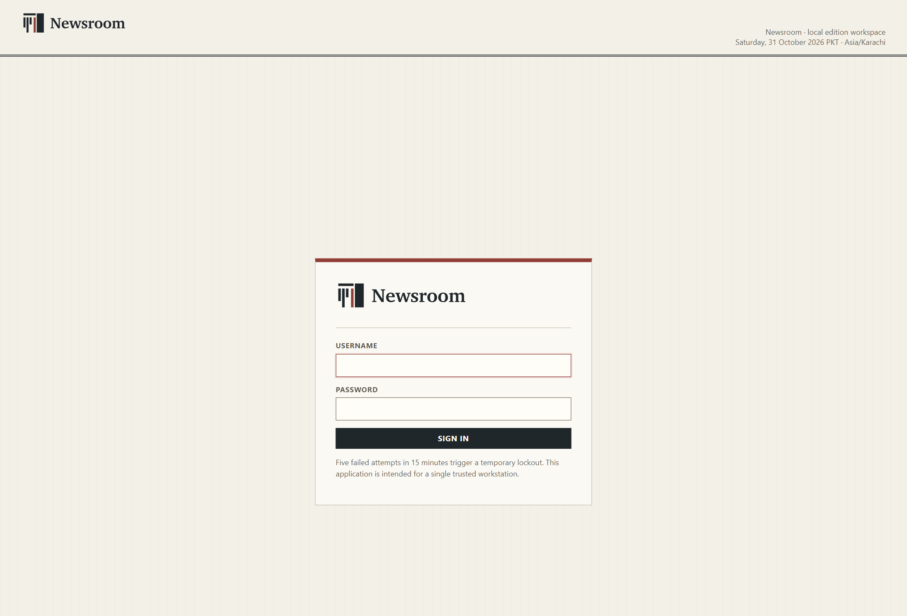

---

## 4. Look around the workspace

After sign-in, the **Dashboard** is your starting point. The header shows:

- the **Newspaper** selector and **Switch** button;
- the current date and time zone;
- your display name and role;
- the main navigation: **Dashboard**, **Sources**, **Stories**, **Articles**, **Build**, **Editions**, **Schedules**, **Jobs**, **AI Models**, **Connections**, **Media cache**, **Branding**, **Appearance**, **Users**, **Audit** and **Diagnostics**.

Some items only appear for roles that can use them. In the tested owner account, every section was visible. The footer repeats the current publication name and the statement **Data stays on this computer.**

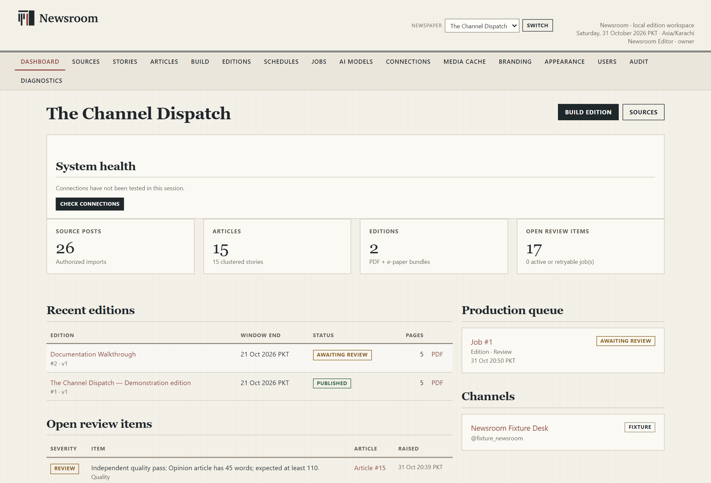

The Dashboard summarises:

| Area | What it tells you |
|---|---|
| **System health** | Whether connections have been checked in this session. Choose **Check connections** to run the read-only checks. |
| **Source posts / Articles / Editions** | Counts of stored posts, clustered stories and editions. |
| **Open review items** | Editorial or quality items that still need a decision. |
| **Recent editions** | The latest editions and their status. |
| **Production queue** | Recent build jobs and their state. |
| **Channels** | Sources authorised for this newspaper. |

### Switch newspapers

If more than one newspaper exists, choose it in the **Newspaper** list and select **Switch**. This changes the working newspaper; it does not publish anything. Each newspaper has its own branding, sources, schedules, drafts, editions and archive.

---

## 5. Optional: make local AI ready

You can skip this section for the fixture demonstration. The fixture composer writes deterministic drafts and does not use a model.

Newsroom does not install Ollama or download model weights by itself. To use a local Qwen3.5 model:

1. Make sure Ollama is installed and running on the same PC. Newsroom deliberately does not start an Ollama service it does not own.
2. In Newsroom, open **AI Models**.
3. Check the model cards. The three reviewed profiles are:

| Profile | Model | Download | Suggested hardware |
|---|---|---:|---|
| **Standard · Recommended** | `qwen3.5:4b-q4_K_M` | 3.32 GB | 6 GB VRAM / 8 GB RAM |
| **Enhanced** | `qwen3.5:9b-q4_K_M` | 6.55 GB | 12 GB VRAM / 16 GB RAM |
| **Compact** | `qwen3.5:2b` | 2.68 GB | 4 GB VRAM / 8 GB RAM |

4. On the model you want, tick **I approve downloading … from the verified Ollama registry**, then choose **Verify and download**. The transfer can take a long time and uses disk space outside the Newsroom data folder.
5. When the profile shows as installed, choose **Select profile**.
6. Choose **Test local model** and wait for the synthetic test to finish.

**Success check:** the selected model is shown as the current model and its readiness says the local test passed. Until then, source drafting is not considered ready.

> **Hardware note:** the suggested figures are guidance, not guarantees. A 9B model on a 6 GB GPU may be slow or may not fit. Compact is a reduced-capability fallback, not an automatic replacement. AI drafts always need human review.

If **AI Models** says **Local AI runtime unavailable**, the Ollama service is not reachable. See **Troubleshooting & FAQ**.

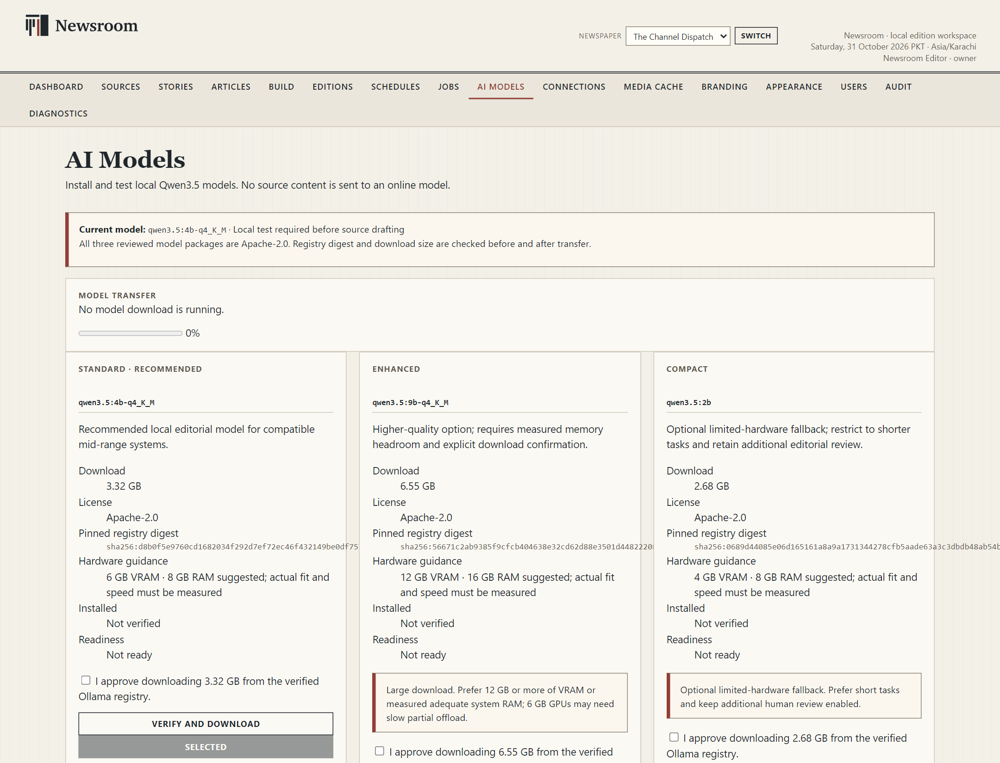

---

## 6. Add an authorised source

Newsroom can work from two kinds of source:

- the **synthetic fixture desk**, which is for practice and is labelled as invented content;
- a **live import** of an export you are authorised to republish.

Public read access to a Telegram channel is **not** permission to republish it. Newsroom asks for a rights declaration before it will treat a live channel as a source.

### Register a channel and record rights

1. Open **Sources**.
2. Under **Register an authorized channel**, enter:

    - **Channel title** — the name shown inside Newsroom;
    - **Internal slug** — a short local identifier;
    - **Telegram handle** — optional, for example `@channel`;
    - **Channel has a public t.me address** — tick only if that is true;
    - **Grantor (person or organisation)** — who granted permission;
    - **Authority basis** — for example, owner of the channel or written permission with a date;
    - **Evidence reference** — where the written permission is filed.
3. Choose **Register channel**.

**What you should see:** the new channel appears on the **Source desk** with its rights status. A missing rights declaration is shown in red and blocks live builds.

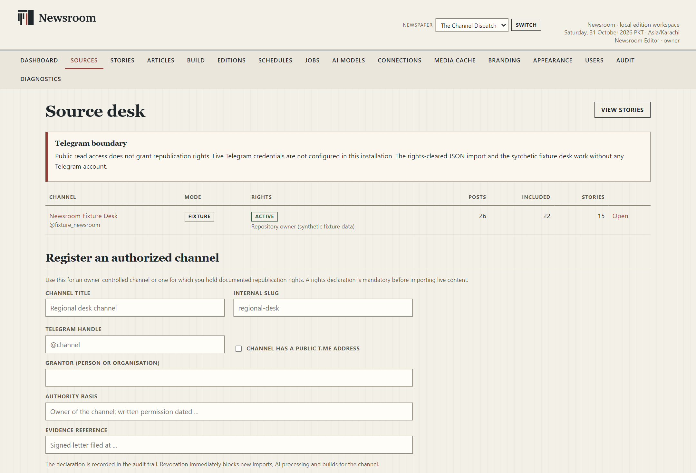

### Import an authorised export

1. Open the channel from the Source desk.
2. Find **Import authorized content**.
3. Choose the **JSON export** file. The owner import format and Telegram Desktop JSON export are supported, up to 40 MB.
4. Optionally choose **Referenced media files** so captions and credits stay linked to the original message.
5. Choose **Import**.

The import summary shows how many posts were read, accepted and excluded. Exclusion is normal: greetings, promotions, link-only posts, forwarded copies, empty messages and similar items are left out with a recorded reason. Open a post's **Why this classification** and use **Editor decision** if a decision is wrong.

### Telegram connection

The installed build includes a **Telegram connection** page for each channel. It exposes the channel handle, **Test source connection**, phone-number sign-in, **Request login code**, **Submit code**, **Finish sign-in**, **Cancel login**, **Import last 30 days (context only)**, **Sync window**, and **Sign out**.

Live Telegram access also requires an API id/hash that the installer does not request or configure in the normal interface. If the page reports **Missing** or **API id/hash are not configured**, live collection is not available on that installation. The verified route in this build is the rights-cleared JSON import; live Telegram login and retrieval could not be verified for this documentation. Do not paste login codes or two-step passwords into chat, email or a support message.

---

## 7. Create or adjust your publication identity

1. Open **Branding**.
2. Set at least:

    - **Publication name** — the masthead name of your newspaper;
    - **Byline (printed under every headline)**;
    - **City**;
    - **Timezone (IANA)** — for example `Asia/Karachi`;
    - **Paper size** — **Tabloid 11 × 17 in** or **A3 297 × 420 mm**;
    - **Volume number**;
    - **Source code policy** and **Public evidence-page base URL** only if you genuinely publish evidence pages.
3. Review **Section order** and the **Automatic research** policy.
4. Choose **Save publication profile**.

**Success check:** the newspaper name in the header and on the Dashboard changes to the name you saved. Existing published editions keep the identity they were printed with.

To create a second newspaper, use **New newspaper** at the bottom of **Branding**. Each newspaper has its own sources, schedules, drafts and archive.

> Do not put the Newsroom logo into your newspaper. The Newsroom identity identifies the software and these manuals; your publication's masthead is your own.

---

## 8. Build your first edition

The demonstration channel already contains sample posts. This walkthrough produced an actual five-page tabloid edition from synthetic fixture data in the tested build.

1. Open **Build**.
2. Choose **Newsroom Fixture Desk (fixture)** as the **Primary source channel**.
3. The fixture window is filled from the sample posts. For a manual walkthrough, set:

    - **Window start** to the beginning of the sample day;
    - **Window end / cutoff** to the following midnight.
4. Enter an **Edition name**, for example `Documentation Walkthrough`.
5. Choose **Queue build**.

**What you should see:** Newsroom opens a job page with a message such as **Build queued. Worker started in the background**. The job moves through classification, normalization, clustering, drafting and layout. A fixture build typically finishes in well under a minute; a live build with media and a local model can take much longer.

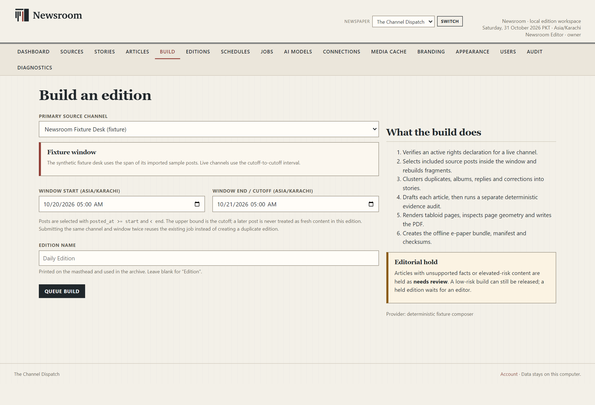

### Follow the job

Open **Jobs** to see queued and recent jobs. A row shows the job number, kind, channel, status, stage, progress, attempt, scheduled time, finish time and any error.

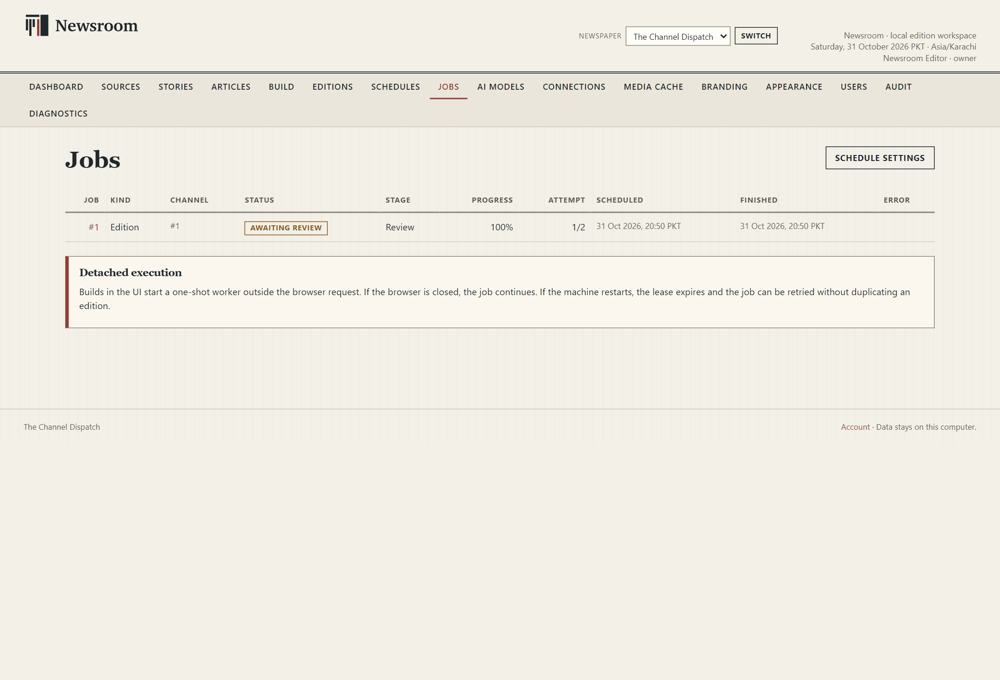

A finished build normally ends in **Awaiting review**. That means the pages and PDF preview exist, but the edition has not been released. This is deliberate: the review step is where a person checks the copy, evidence, images and layout.

> **Do not close the window with the X while a build is running unless you choose carefully.** Closing offers **Continue in background**, **Pause safely and exit**, and **Keep open**. **Continue in background** hides the window but leaves the local service and queued work running. **Pause safely and exit** waits for safe checkpoints before stopping. See section 11.

---

## 9. Review the edition and open the preview

1. Open **Editions**.
2. Choose the new edition. Its status is **Awaiting review**.
3. The edition workspace lists all articles on the left, the selected article in the middle and **Newspaper preview** on the right.
4. Read the **Release held** panel. It names every open review item that must be resolved before release. Typical items include an elevated-risk story, an anonymous or unverified claim, or a quality pass that finds the article shorter than its genre expects.
5. Select an article and review its **Draft text**, **Source evidence**, **Claims**, **Chronology**, **Revision history** and **Published snapshot** (for a previously published version).
6. Use **Open preview PDF** to inspect the actual rendered pages. Use **Rebuild preview only** after changing copy if the page preview is out of date.

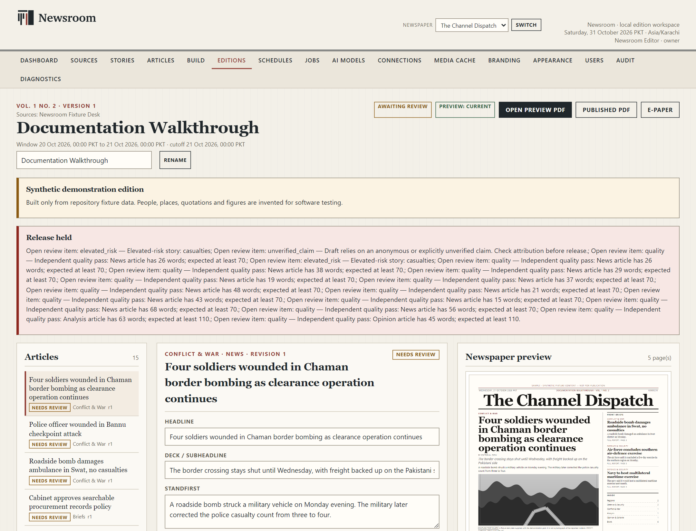

### Resolve review items

For each article:

1. Open the article from the edition workspace or **Articles**.
2. Read **Draft text** and compare it with **Source evidence**.
3. In **Review items**, choose **Approve item** or **Reject item** and add a short decision note where prompted.
4. Use **Re-run independent audit** if you have changed the text and want a fresh audit.
5. Set **Article status** to **Approved** when the item is ready. **Hold**, **Needs research**, **Excluded** and **Draft** are also available.
6. Return to the edition and choose **Rebuild preview only** if the copy changed.

The exact number of items depends on the articles. A risk item is not a formality: confirm attribution, wording and whether the story should run at all.

**Success check:** the **Release held** panel no longer lists blockers, and **Release version 1** becomes available. If it remains disabled, open each article and resolve the remaining review items.

---

## 10. Release the edition and find the PDF and e-paper

When the edition is clean:

1. In the edition workspace, choose **Release version 1** under **Release**.
2. **What you should see:** the status becomes **Published** and an **Immutable release** badge appears. The edition and its manifest can no longer be changed.

Published files are available from the edition:

| Button | What it opens |
|---|---|
| **Published PDF** | The frozen tabloid PDF |
| **E-paper** | The offline page-turner and text edition |
| **Open preview PDF** | The working preview, when one exists |

You can also open **Editions** and use the **PDF** or **E-paper** links in the row.

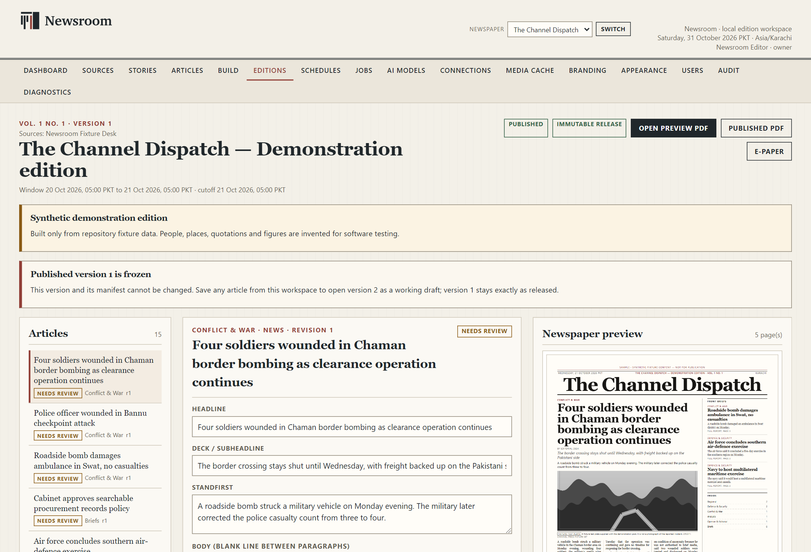

### The e-paper

The e-paper is a self-contained bundle. It includes page navigation, a text edition and a source appendix. Open it from the edition's **E-paper** button. The same files are in the edition folder on disk, so the bundle can be opened without the Newsroom server.

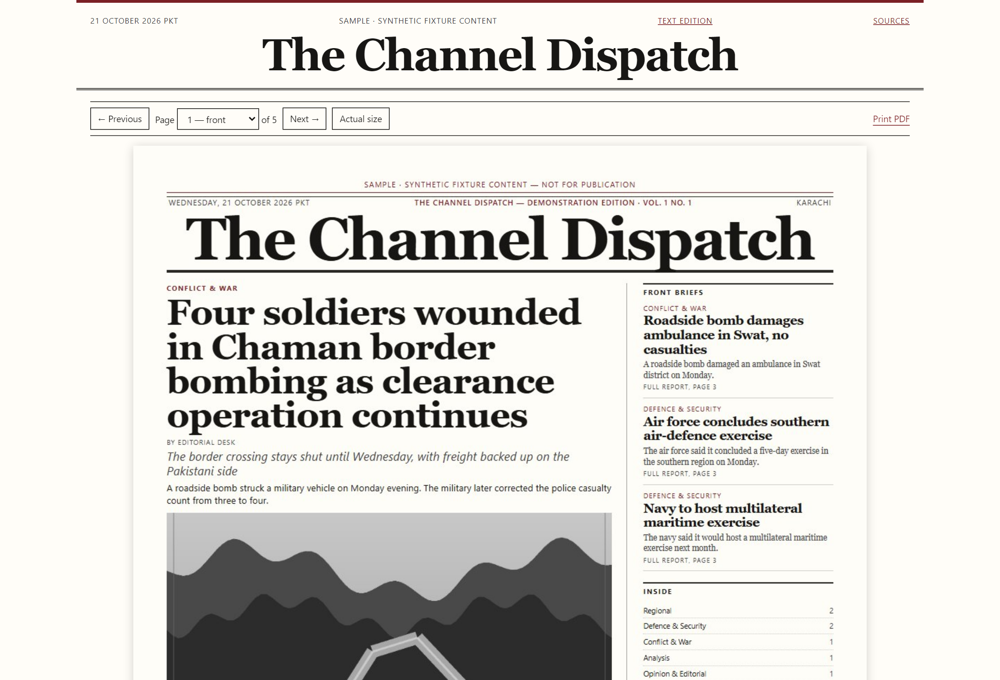

### Where the files are

Published editions are stored under:

```text
%LOCALAPPDATA%\ChannelPress\output\<publication-slug>\<edition-folder>\
```

A typical edition folder contains the PDF, page proofs, the e-paper bundle, a manifest and checksums. The exact folder name is shown in the edition's **Provenance** section. Do not rename or edit files inside a published edition folder; that would break its checksums.

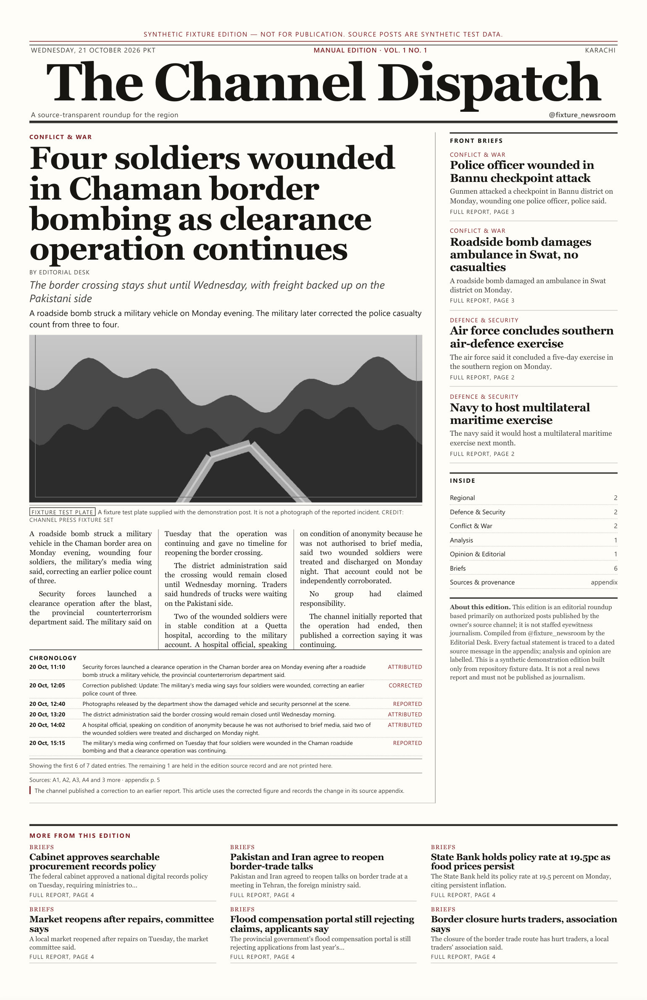

---

## 11. Close, reopen and keep work safe

Closing the window with the X does not simply quit. Newsroom asks what should happen to work that is still running:

| Choice | Result |
|---|---|
| **Continue in background** | Hides the window and leaves the local service and queued work running. Launch Newsroom again to restore the existing window. |
| **Pause safely and exit** | Waits for the worker and model operations to reach safe checkpoints, then closes the window and stops the local service. This can take a little time. |
| **Keep open** | Returns to the application without closing anything. |

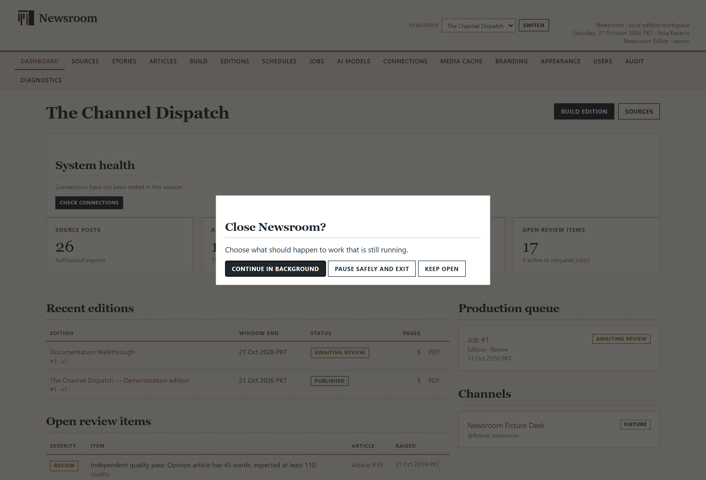

Only one Newsroom window can run at a time. If you launch the application again while it is in the background, Newsroom focuses the existing window rather than starting a second copy. This protects the database and the Telegram session.

### Success checklist

- [ ] Newsroom opens in one **Newsroom** window with no console.
- [ ] You can sign in with your owner account.
- [ ] The Dashboard shows your newspaper and its counts.
- [ ] Your source appears in **Sources** with a rights status.
- [ ] A build reaches **Awaiting review** or **Published** without an unexplained error.
- [ ] The edition preview opens and shows real pages.
- [ ] A released edition has a **Published PDF** and an **E-paper** link.
- [ ] The e-paper opens and its pages and sources are readable.
- [ ] You know where `%LOCALAPPDATA%\ChannelPress` is and how to back it up.

If any step does not match, go to **Troubleshooting & FAQ** before deleting data or reinstalling.

---

## 12. What this build does not do

Be aware of these limits before relying on Newsroom for a real issue:

- **No cloud account, subscription or external publishing.** Editions are released locally; there is no automatic upload to a website or social network.
- **No bundled AI.** Local models are separate Ollama downloads and may not fit your hardware. AI output is assistive and requires editorial review.
- **No guaranteed live Telegram access.** The Telegram connection page exists, but the API credentials are not set by the installer. Live login and retrieval were not verified in this documentation. The rights-cleared JSON import is the verified route.
- **No automatic unattended schedule when the app is closed.** A schedule defines the cutoff and window and can be run with **Run the latest cutoff now**; automatic background runs depend on a Windows task or another worker setup that this installer does not create. See **Installation & Maintenance**.
- **No EPUB, HTML newsletter or email export.** The verified outputs are the tabloid PDF, page proofs and the offline e-paper bundle.
- **No in-app backup button.** Back up by closing Newsroom and copying the data folder; see **Installation & Maintenance**.
- **The demonstration content is synthetic.** Never publish it as real reporting.

For the full control reference, continue with the **User Manual**. For editorial judgement and release practice, read the **Editorial & Publishing Guide**.
