# Newsroom — User Manual

**Product:** Newsroom 1.0.0 for Windows  
**Audience:** Owners, editors and operators who use Newsroom day to day  
**Last verified against:** the packaged build of 31 October 2026, using a disposable demonstration profile

This manual is the control reference for the installed application. It explains each screen, the fields it exposes and the result you should expect. It does not teach installation, command-line tools or source-code development. For a first run, use **Quick Start**. For editorial judgement and release practice, use the **Editorial & Publishing Guide**.

> **About the illustrations:** every screenshot in this manual comes from a disposable demonstration profile. The newspaper, people, places, quotations and figures shown in it are synthetic test data. They are not reporting and must not be presented as news.

---

## 1. How Newsroom is organised

Newsroom is a single-window Windows application. The window contains a header, a navigation bar and a working area. All data stays on the computer. Editions are prepared, reviewed and released locally; there is no account, subscription or automatic upload to a website.

### 1.1 The header

The header is present on every screen:

| Element | Meaning |
|---|---|
| **Newspaper** selector and **Switch** | Chooses which newspaper you are working in. Switching does not publish anything. |
| Date, time and time zone | The current local time in the newspaper's configured zone. |
| Your display name and role | For example `Newsroom Editor · owner`. The name also appears in the audit trail. |
| Navigation | The main sections listed below. Some items appear only for roles that can use them. |
| Footer | The current publication name and the statement **Data stays on this computer.** |

### 1.2 Navigation

| Section | What it is for |
|---|---|
| **Dashboard** | Health, counts, recent editions, open review items, the production queue and channels. |
| **Sources** | The source desk: authorised channels, rights declarations, imports, collection windows and source posts. |
| **Stories** | Clustered stories with claims, source fragments, research context and chronology. |
| **Articles** | The article list and the full article editor with audit and review controls. |
| **Build** | Queue a new edition from a source channel and a cutoff window. |
| **Editions** | The edition archive, release state and PDF/e-paper links. |
| **Schedules** | Cutoff and release times, review policy and catch-up controls. |
| **Jobs** | Build jobs, stages, progress, errors and recovery actions. |
| **AI Models** | Local Qwen3.5 model download, selection and readiness test. |
| **Connections** | Read-only checks for local services, storage, renderer and network access. |
| **Media cache** | A dry-run view of deletable media and protected media. |
| **Branding** | Publication identity, paper size, sections, research policy, newspapers, sources and editors. |
| **Appearance** | Colours, fonts, type metrics, print proof and theme revisions. |
| **Users** | Accounts, roles, passwords and access. |
| **Audit** | The local audit trail of actions. |
| **Diagnostics** | Component status, configuration values and data/privacy notes. |

### 1.3 Roles

Newsroom exposes four roles: **Viewer**, **Operator**, **Editor** and **Owner**. In the tested owner account, every section was visible. Other roles may see fewer controls. The exact permission boundary for each role was not exhaustively tested for this manual; if a control is missing, check the role on **Users** before assuming a fault.

### 1.4 The working newspaper

Each newspaper has its own masthead and branding, source list, schedules, drafts, editions and archive. The **Newspaper** selector changes which one you are working in. A second newspaper is created from **Branding**, not by copying the data folder.

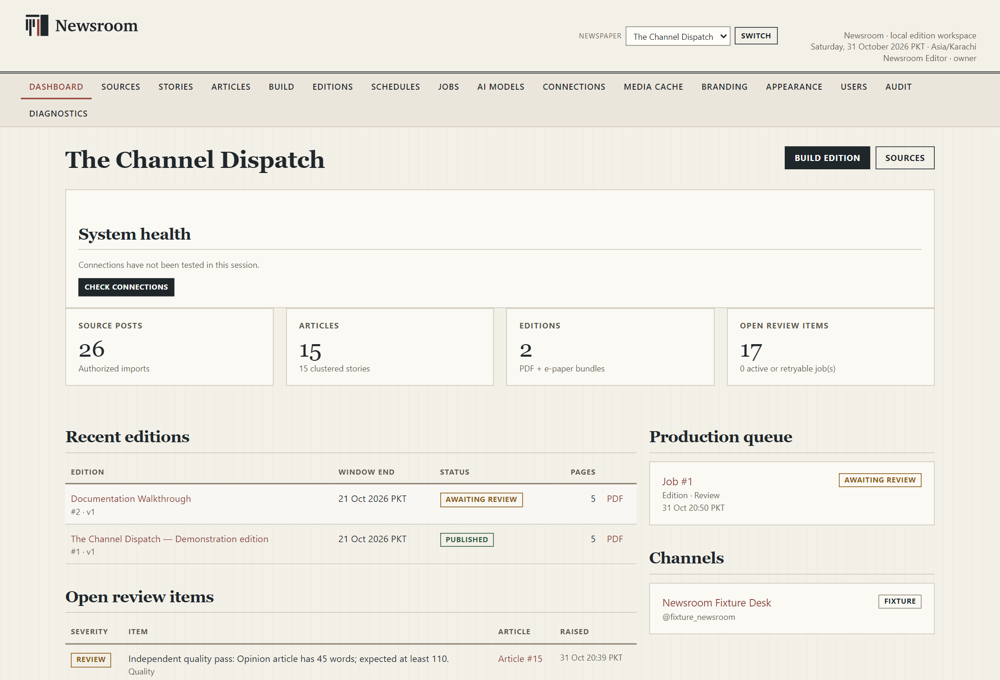

---

## 2. Dashboard

The Dashboard answers three questions: is the installation healthy, what needs a decision, and what was produced recently.

### 2.1 System health

On a new session the panel says **Connections have not been tested in this session.** Choose **Check connections** to run the same read-only checks as the **Connections** page. The result is a status, a short explanation and a next step. The check does not download models, contact Telegram or change data.

### 2.2 Counts

| Card | Meaning |
|---|---|
| **Source posts** | Stored posts from authorised imports, with the subtitle **Authorized imports**. |
| **Articles** | Draft and published article records, with the number of clustered stories underneath. |
| **Editions** | Editions in the archive, with the subtitle **PDF + e-paper bundles**. |
| **Open review items** | Editorial or quality items still awaiting a decision. The line underneath reports active or retryable jobs. |

### 2.3 Recent editions

The table shows the edition name, window end, status, page count and a **PDF** link. A published edition is marked **PUBLISHED**. Select the edition name to open its workspace.

### 2.4 Open review items

Each row shows severity, the item text, the article number and when it was raised. Typical items are independent quality passes, for example:

> **REVIEW** Independent quality pass: Opinion article has 45 words; expected at least 110.

Select the article to open it and decide the item. Quality items are advisory in tone but they still block release until they are approved or rejected.

### 2.5 Production queue and channels

The production queue lists recent jobs. If nothing has run, it says **No jobs recorded.** The **Channels** panel lists the sources authorised for this newspaper, their mode and handle. A fixture channel is marked **FIXTURE**.

---

## 3. Sources

**Sources** is the source desk. It is where a channel becomes an authorised source, where its rights are recorded and revoked, and where imported posts are inspected.

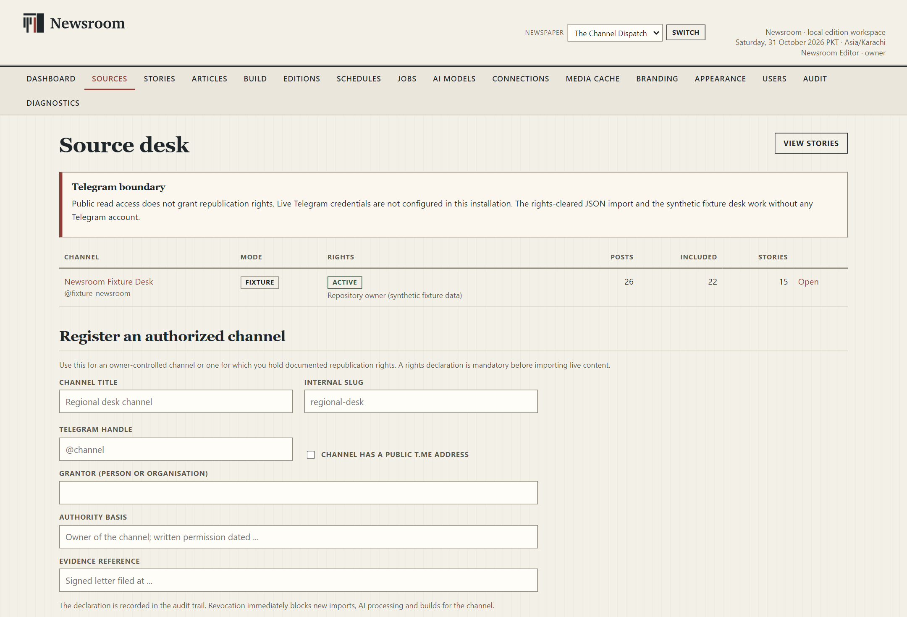

### 3.1 The Telegram boundary

The page states the rule plainly:

> Public read access does not grant republication rights. Live Telegram credentials are not configured in this installation. The rights-cleared JSON import and the synthetic fixture desk work without any Telegram account.

Treat this as an editorial rule, not only a technical one. A channel you can read is not a channel you may republish.

### 3.2 The channel table

| Column | Meaning |
|---|---|
| **Channel** | Title and handle. Select **Open** to see the source detail. |
| **Mode** | `FIXTURE` for the synthetic desk or the live-import mode for an authorised channel. |
| **Rights** | `ACTIVE` when a rights declaration is in force. |
| **Posts / Included / Stories** | Stored post count, posts accepted into processing and clustered stories. |

### 3.3 Register an authorised channel

Use **Register an authorized channel** for an owner-controlled channel, or one for which you hold documented republication rights. A rights declaration is mandatory before live content can be imported.

1. Enter **Channel title** — the name shown inside Newsroom.
2. Enter **Internal slug** — a short local identifier.
3. Enter **Telegram handle** — optional, for example `@channel`.
4. Tick **Channel has a public t.me address** only when that is true.
5. Enter **Grantor (person or organisation)**.
6. Enter **Authority basis** — for example, owner of the channel, or written permission with a date.
7. Enter **Evidence reference** — where the written permission is filed.
8. Choose **Register channel**.

**What you should see:** the channel appears on the Source desk with its rights status. The declaration is written to the audit trail. Revocation immediately blocks new imports, AI processing and builds for that channel.

> **Do not use a public channel you merely follow.** Permission to read is not permission to republish. If you cannot name the grantor and the evidence, do not register the channel as a source.

### 3.4 Source detail

Open a channel to reach its detail page.

| Area | What it shows or does |
|---|---|
| **Build from this channel** | Opens **Build** with this channel selected. |
| **Rights status** | `Active` or the blocking state, with the grantor beneath it. |
| **Reporting window available** | The span of stored posts that can be used. |
| **Access** | The access note, for example **Owner** and **Private source; message IDs only**. |
| **Open Telegram connection** | Opens the channel's Telegram page. |
| **Collection windows** | Window, status, stored posts, fetched, included and excluded counts. |
| **Import authorized content** | The JSON import form. |
| **Rights declarations** | Grantor, authority basis, scope, acceptance time and status, with **Revoke**. |
| **Record a new rights declaration** | Adds a new declaration without deleting the old record. |
| **Source posts** | The post table with a per-post editorial decision. |
| **Imports** | File, kind, imported time, raw/accepted/excluded counts and SHA-256. |
| **Schedules** | The schedules attached to this channel. |
| **Recent stories** | The latest clustered stories, with section, importance and risk. |

### 3.5 Import an authorised export

The import route is the verified way to bring in live content on this installation.

1. In **Import authorized content**, choose the **JSON export** file. The owner import format and Telegram Desktop JSON export are supported, with a maximum of 40 MB.
2. Optionally choose **Referenced media files** so captions and credits stay linked to the original message. Derivative images are reversible copies; originals remain in the data directory.
3. Choose **Import**.

Files are treated as untrusted data. Embedded instructions in a post never become policy. The import summary reports raw, accepted and excluded counts. Exclusion is normal: empty messages, forwarded copies, promotion-only posts, channel administration and similar items are left out with a recorded reason.

### 3.6 Decide a single post

Each source post has a state and, where relevant, a classification reason. Use **Why this classification** to read the explanation. Then choose one of:

- **Include in story processing**
- **Exclude from story processing**
- **Include as context only**
- **Mark as promotional**
- **Mark as channel administration**
- **Mark as profanity/abuse**

Choose **Apply decision**. An included post can later be withdrawn with one of **Rights withdrawn**, **Deleted at source**, **Duplicate** or **Promotion only**, followed by **WITHDRAW**. Withdrawal is recorded; it does not silently erase the audit trail.

### 3.7 Telegram connection

The source's Telegram page exposes the live connection controls:

- **Credentials**, **Signed in** and **Login stage**.
- **Channel handle**, with **Save handle**.
- **Test source connection**.
- **Phone number (international format)** and **Request login code**.
- **Submit code**, **Finish sign-in** and **Cancel login** when a login is in progress.
- The effective cutoff-to-cutoff window, **Committed watermark** and stored included posts.
- **Import last 30 days (context only)**.
- **Sync window**.
- **Window and retrieval history**.

On the tested installation the page reported **Missing** for the API id/hash and explained that live credentials were not configured. Live Telegram login and retrieval could not be verified for this documentation. The rights-cleared JSON import is the verified route. Never place a login code, two-step password or API hash in a chat, email or document.

---

## 4. Stories

A **story** is the cluster of source posts that belong together: the original report, updates, corrections, replies and album items. A story is not yet an article; it is the evidence bundle from which an article is drafted.

### 4.1 The story list

The list can be filtered by **Channel** and **Section**, then refreshed with **Filter**. Columns show the story headline, section, genre, risk, importance, status and last update. Importance is a decimal score; risk is `LOW` or `HIGH`.

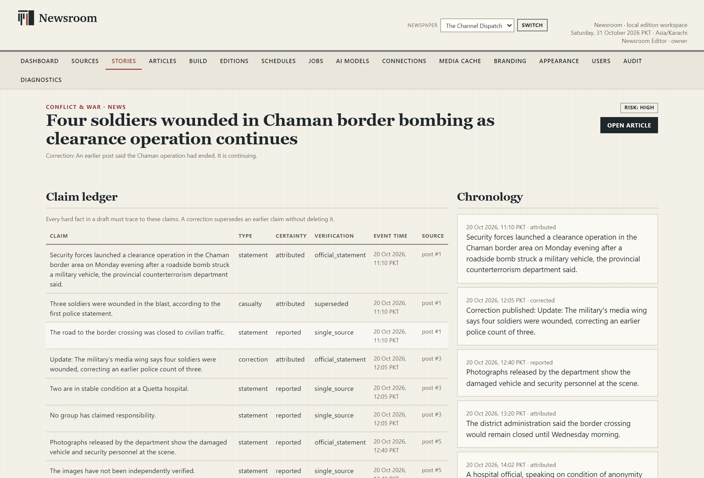

### 4.2 The evidence record

Open a story to see:

| Panel | Meaning |
|---|---|
| **Claim ledger** | Every hard fact in the draft, with claim type, certainty, verification state, event time and source post. A correction supersedes an earlier claim without deleting it. |
| **Source fragments** | The original messages, with message number and local time. |
| **Research context** | **Search sources** and **Add URL**, plus the research policy in force. Candidates stay out of the paper until an editor accepts them. |
| **Chronology** | The sequence of attributed, reported and corrected events. |
| **Story state** | Fingerprint, creation time, update time and originating channel. |

The claim ledger is the most important panel. A claim marked `unverified`, `single_source` or `superseded` deserves a decision before the article is approved. An accepted research page is attributed context, not automatic verification.

### 4.3 Research context

The research control depends on the publication's **Automatic research** policy. On the tested build the story page showed **Search: Publisher RSS feeds · Ready · Policy: editor triggered**, with **Search sources** and **Add URL**. The page states that candidates stay out of the paper until an editor accepts them, and that accepted pages are attributed context rather than verification.

Automatic web research providers were not exercised for this documentation. Do not assume that a search provider is configured or that a result has been fact-checked by Newsroom.

---

## 5. Articles

**Articles** is the editorial list. Each article belongs to a story and can appear in one or more editions.

### 5.1 The article list

Filters:

- **Status** — **All statuses**, **Draft**, **Needs Review**, **Approved**, **Rejected**.
- **Channel** — **All accessible** or a named channel.
- **Search** — free text.
- **Filter** — applies the selection.

The table shows the article headline and deck, section, genre, status, risk, word count, revision and update time. Select a headline to open the editor.

### 5.2 The article editor

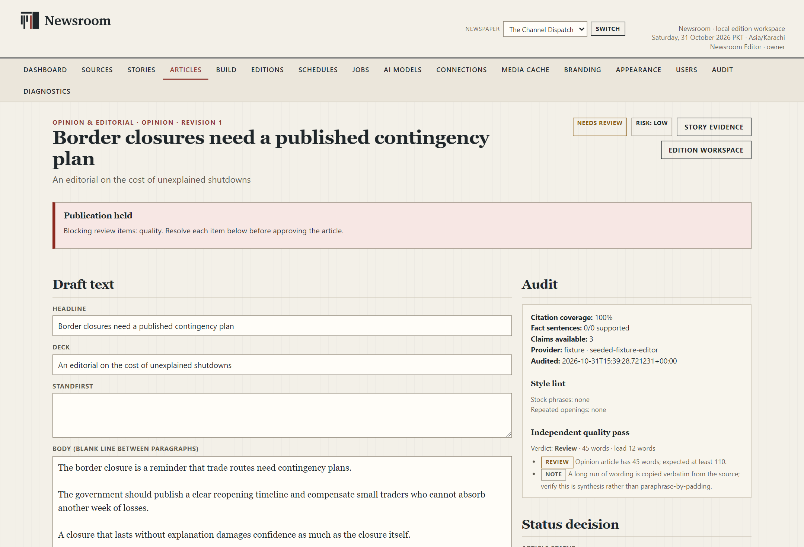

The editor is divided into a main column and a side column.

**Main column**

| Field or control | Purpose |
|---|---|
| **Headline** | The printed headline. Keep it accurate and supported by the text. |
| **Deck** | The subheadline under the headline. |
| **Standfirst** | A short introductory paragraph where the layout uses one. |
| **Body (blank line between paragraphs)** | The article text. A blank line separates paragraphs. |
| **Byline** | Printed under the headline when the publication uses one. |
| **Section** | One of the configured sections: **National & Internal**, **Regional**, **International & Geopolitics**, **Defence & Security**, **Conflict & War**, **Analysis**, **Opinion & Editorial**, **Briefs**. |
| **Genre** | **News**, **Analysis**, **Opinion**, **Editor Note** or **Brief**. |
| **Lock this headline and text against regeneration** | Prevents a later drafting run from replacing your text. |
| **Save revision** | Saves a new revision and updates the preview state. |
| **Undo unsaved changes** | Reverts the form to the last saved revision. |
| **Re-run independent audit** | Runs the evidence and quality checks again against the current saved text. |

**Side column**

| Panel | Meaning |
|---|---|
| **Versions** | The revision history. Each entry records the time and the saved field values. |
| **Sources used** | The channel, post count and earliest post recorded when the article was drafted. A merged story credits every contributing channel. Later source changes do not rewrite this record. |
| **Review items** | Category, severity, message, status and decision, with **Approve item** and **Reject item**. |
| **Audit** | Citation coverage, fact sentences supported, claims available, provider and audit time. |
| **Style lint** | Stock phrases and repeated openings. |
| **Independent quality pass** | A verdict with word count and lead length, plus review notes. |
| **Status decision** | **Article status** with **Update status** and **Lock article**. |
| **Media** | The selected lead image or **No selected media.** |
| **External context** | Accepted references and their role. |
| **Appears in** | Editions and versions that include the article. |

### 5.3 Article status

The status menu offers **Draft**, **Needs review**, **Needs research**, **Approved**, **Held** and **Excluded**. Choose the status that reflects the editorial decision, then **Update status**.

- **Approved** means the article is ready for a clean release. It does not mean the facts are proven; it means an editor accepted responsibility.
- **Held** keeps the article out of release while preserving the work.
- **Excluded** removes it from the edition. The record remains available.
- **Needs research** is appropriate when a claim is unresolved.

A **Publication held** notice appears at the top of an article when blocking review items remain. The notice names the blocking category. Resolve each item before approving.

### 5.4 Review items

For each open item:

1. Read the message and open the relevant evidence.
2. Choose **Approve item** when the item is acceptable, or **Reject item** when it is not.
3. Add a short decision note when the form asks for one.
4. Re-run the audit if you changed the text.

Approving a quality item does not edit the article. If the item is valid, improve the copy, save a revision, then rebuild the edition preview.

### 5.5 The audit panels

The audit is a deterministic check, not a truth oracle.

- **Citation coverage** reports the proportion of sentences that trace to source material.
- **Fact sentences** reports how many are supported.
- **Claims available** is the size of the claim ledger.
- **Style lint** flags repeated openings and stock phrases.
- **Independent quality pass** compares length and lead construction with the genre expectation. A short opinion piece or a brief can legitimately trigger a review.

A clean audit does not make a false sentence true. Read the source fragments and the claim ledger.

### 5.6 Media

The article editor shows the current lead media, its type and dimensions, a **Download original** link and fields for **Caption** and **Credit**. Use **Remove lead media from the layout** to drop it. Eligible source assets can be chosen as a replacement, with **Caption for replacement** and **Credit for replacement**. **Supporting media (optional)** can be promoted from a source asset.

The layout deliberately limits images: briefs and narrow columns do not receive a second picture. Captions and credits must match the source. Do not use an image merely because it is available.

### 5.7 Locks

**Lock article** and **Lock this headline and text against regeneration** protect approved work. A lock is an editorial signal as well as a technical one. Release the lock deliberately if the article must be regenerated.

---

## 6. Build an edition

**Build** turns selected source posts into a new edition.

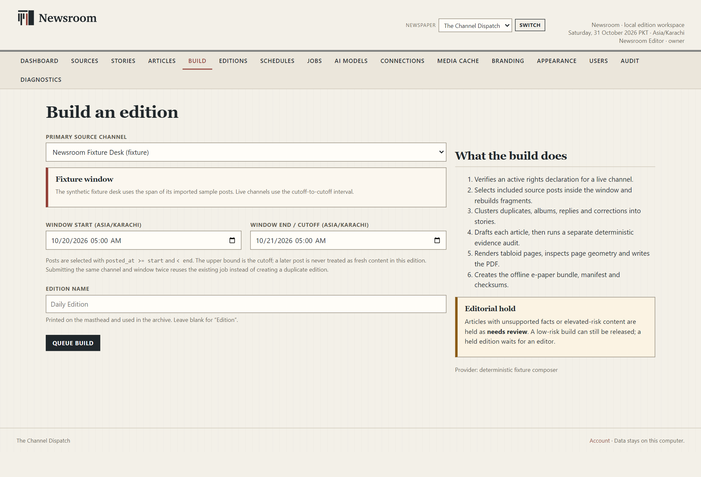

### 6.1 Fields

| Field | Meaning |
|---|---|
| **Primary source channel** | The channel for this build. Fixture channels are labelled `(fixture)`. |
| **Window start (Asia/Karachi)** | The first instant included. |
| **Window end / cutoff (Asia/Karachi)** | The upper bound. A post at exactly this instant belongs to the next issue. |
| **Edition name** | Printed on the masthead and used in the archive. Leave blank for **Edition**. |
| **Queue build** | Creates the job. |

Posts are selected with `posted_at >= start` and `< end`. Submitting the same channel and window twice reuses the existing job instead of creating a duplicate edition.

For a fixture channel, the window is filled from the span of the imported sample posts. For a live channel, use the cutoff-to-cutoff interval.

### 6.2 What the build does

The page lists the stages:

1. Verifies an active rights declaration for a live channel.
2. Selects included source posts inside the window and rebuilds fragments.
3. Clusters duplicates, albums, replies and corrections into stories.
4. Drafts each article, then runs a separate deterministic evidence audit.
5. Renders tabloid pages, inspects page geometry and writes the PDF.
6. Creates the offline e-paper bundle, manifest and checksums.

The **Editorial hold** note explains that articles with unsupported facts or elevated-risk content are held as needing review. A low-risk build can still be released; a held edition waits for an editor.

### 6.3 After queueing

**What you should see:** a job page with a message such as **Build queued. Worker started in the background**. The job moves through its stages. A fixture build normally finishes in under a minute. A live build with media and a local model can take much longer.

A finished build normally ends in **Awaiting review**, not **Published**. Open **Editions** to review it.

---

## 7. Jobs

**Jobs** lists queued, running and finished work.

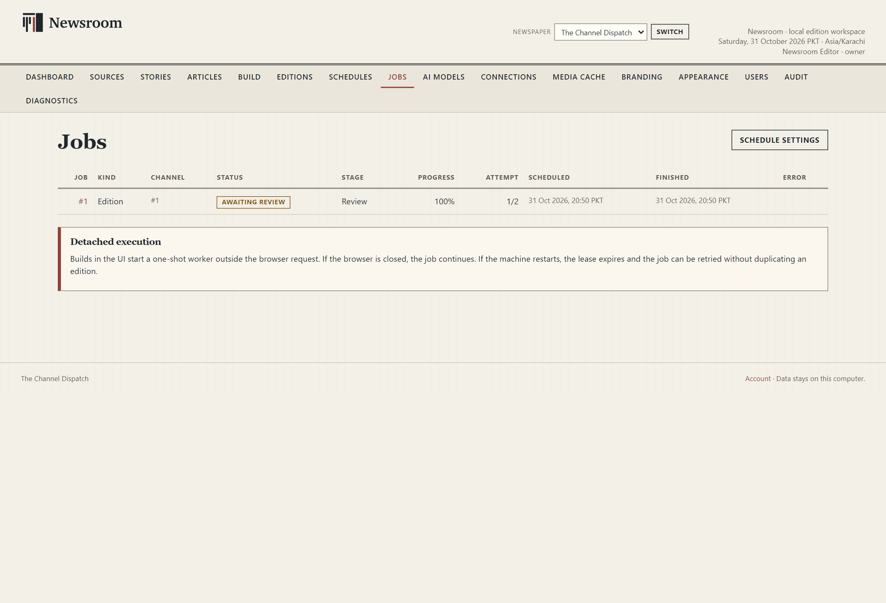

### 7.1 The list

Columns: **Job**, **Kind**, **Channel**, **Status**, **Stage**, **Progress**, **Attempt**, **Scheduled**, **Finished**, **Error**. Select a job number to open its detail.

### 7.2 Job detail

The job page shows the status, attempt count, a progress bar, the current stage and percentage, the step list with per-step state, the result, actions and timing.

Common statuses include **Scheduled**, **Queued**, **Running**, **Awaiting review**, **Published**, **Failed**, **Paused** and **Cancelled**. The exact status set depends on the job; read the badge rather than assuming a sequence.

### 7.3 Actions

| Action | When to use it |
|---|---|
| **Retry failed job** | After the cause of a failure is understood. |
| **Continue from checkpoint** | Resume a paused or interrupted job without discarding completed work. |
| **Stop safely** | Ask the worker to stop at a checkpoint. |
| **Restart from beginning** | Discard the current draft state and start the job again. |
| **Cancel job** | Abandon the job permanently. The source checkpoint is retained for a later manual build. |

**Cancel job** cannot be undone. Use it only when you do not intend to finish that job.

### 7.4 Detached execution

Builds start a one-shot worker outside the browser request. If the window is hidden with **Continue in background**, the job continues. If the machine restarts, the lease expires and the job can be retried without duplicating an edition. The worker is still part of the local application; it is not a cloud service.

---

## 8. Editions

**Editions** is the archive of prepared and released issues.

### 8.1 The edition list

| Column | Meaning |
|---|---|
| **Edition** | Name and number. Select it to open the workspace. |
| **Date** | The edition date in the publication time zone. |
| **Mode** | For example **Manual**. |
| **Status** | `PUBLISHED`, `AWAITING REVIEW` and other states. |
| **Sources** | **ALL SOURCES** or the contributing channels. |
| **Pages** | Page count. |
| **Version** | The published or working version number. |
| **Released** | Release time, when published. |
| **Files** | **PDF** and **E-paper** links. |

### 8.2 The edition workspace

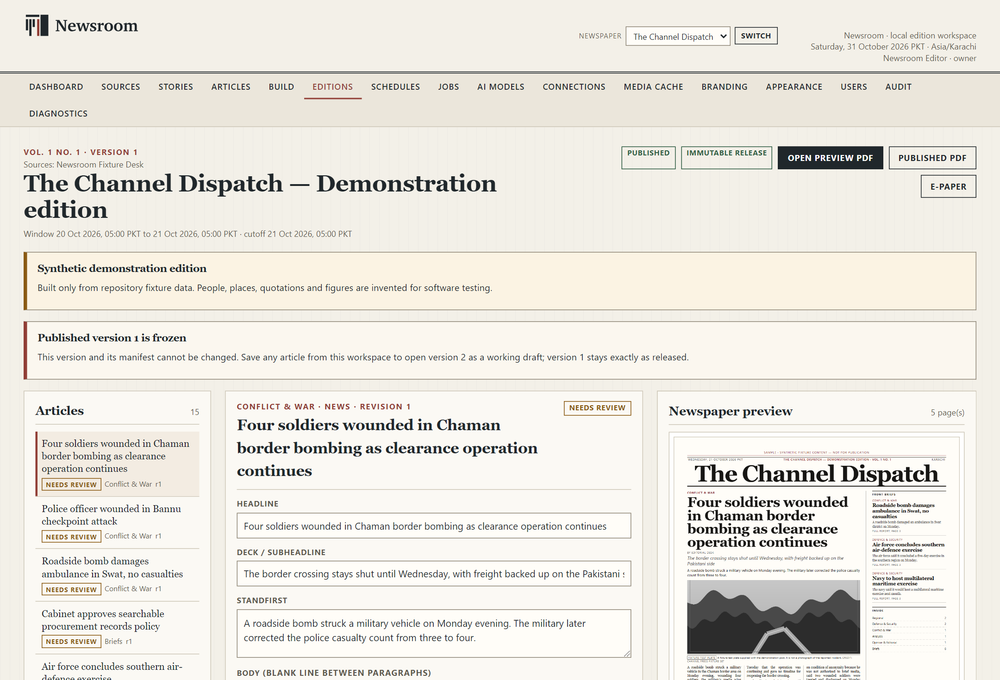

The workspace has three columns:

- **Left:** the article list, the version family and the release controls.
- **Middle:** the selected article with its draft fields, media and review items.
- **Right:** the newspaper preview, page list and article panels.

The header shows the volume and issue number, the source channels, the window and cutoff, the status badge and the output buttons. For a published edition the badge reads **Immutable release**.

### 8.3 Output buttons

| Button | What it opens |
|---|---|
| **Open preview PDF** | The working preview PDF, when one exists. |
| **Published PDF** | The frozen PDF of the released version. |
| **E-paper** | The offline page-turner and text edition. |

**Published PDF** and **E-paper** appear for a released edition. **Open preview PDF** appears when a working preview exists. If a button is missing, the corresponding file has not been produced.

### 8.4 Release held

Before release, the workspace shows a **Release held** panel naming every blocking item. The release button stays disabled until the blockers are resolved.

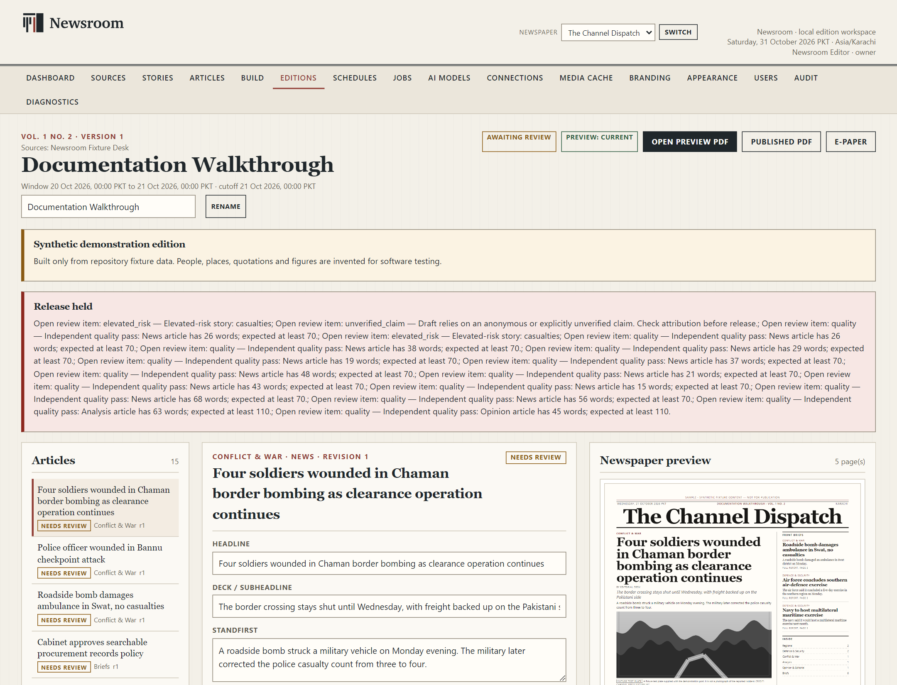

Typical blockers:

- a story with elevated risk;
- an anonymous or unverified claim;
- an independent quality pass that finds the article shorter than its genre expects;
- a preview that no longer represents the saved text.

Resolve blockers in the article's **Review items** and **Status decision** panels, then rebuild the preview if the copy changed.

### 8.5 Preview state

The header reports **Preview: current**, **Preview: stale** or another state. A stale preview means saved editorial changes are not in the rendered pages. The page offers **Rebuild preview now** or **Rebuild preview only**. Do not release a stale preview.

### 8.6 Release a version

1. Confirm that every blocker is resolved.
2. Choose **Release version N**.

**What you should see:** the status becomes **Published**, an **Immutable release** badge appears, and the output buttons become available. The edition and its manifest can no longer be changed. There is no automatic upload.

### 8.7 Versions and corrections

A published version is frozen. To correct it, choose **Open working version N+1**. That creates a draft from the latest saved revisions while version N stays exactly as released. Edit, review, rebuild the preview and release the new version.

The **Versions** panel lists each version with its status, a short SHA and the release time. Select a version to inspect it. The old version remains in the archive as the audit trail.

### 8.8 Edition quality

The **Edition quality** panel reports:

- **Pages**
- **Warnings**
- **Page fill:** average and lowest percentage
- **Underfull pages**, with the note **(reported, not a proof failure)**
- **PDF bytes**
- **PDF SHA**

Underfull pages are a layout observation. They are worth inspecting, especially in a thin edition, but they do not by themselves block release.

### 8.9 Editing inside the workspace

The middle column repeats the article fields and adds media controls. Changes use **Save and update preview** or **Save revision**. The workspace also shows **Source evidence**, **Claims**, **Chronology**, **Revision history** and, for a released version, **Published snapshot**.

If the published snapshot and the current content hash differ, the workspace marks the article as changed. Saving from a published workspace opens the working version described above.

### 8.10 Provenance

The **Provenance** panel states the source basis and the edition folder on disk. For a fixture edition it also states that only synthetic fixture data was used. Do not rename or edit files in a published edition folder; that would break its checksums.

---

## 9. Schedules

**Schedules** defines when a cutoff occurs and when a reviewed edition may be released. The two times are separate.

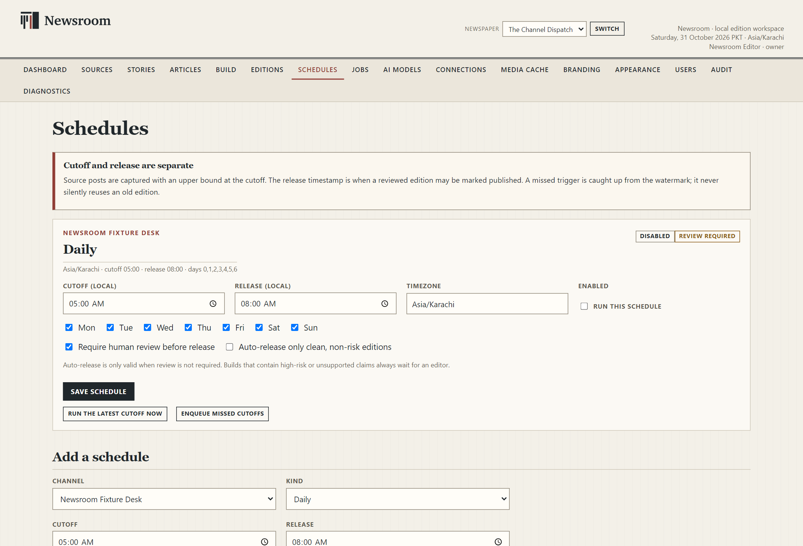

### 9.1 The schedule card

| Field or control | Meaning |
|---|---|
| **Kind** badge | **Daily**, **Weekly roundup** or **Monthly roundup**. |
| **Cutoff (local)** | The upper bound for source posts. |
| **Release (local)** | The time from which a reviewed edition may be marked published. |
| **Timezone** | The IANA zone used for both times. |
| **Enabled** | Turns the schedule on. New schedules start disabled. |
| **Days** | Monday to Sunday checkboxes. |
| **Require human review before release** | Keeps release manual. This is the safe default. |
| **Auto-release only clean, non-risk editions** | Allows automatic release only when review is not required and no high-risk or unsupported claim is present. |
| **Save schedule** | Saves the settings. |
| **Run the latest cutoff now** | Runs the most recent cutoff immediately. |
| **Enqueue missed cutoffs** | Queues cutoffs that were missed while the application was not running. |

A missed trigger is caught up from the watermark; it never silently reuses an old edition. Builds with high-risk or unsupported claims always wait for an editor.

### 9.2 Add a schedule

Choose the channel, the kind, the cutoff, the release time and the timezone, then **Create schedule**. New schedules start disabled and in review-required mode. Enable the schedule deliberately after checking the times.

### 9.3 What is not automatic

The installer does not create a Windows scheduled task. On the tested installation, a schedule is useful for defining the cutoff and release policy and for running or catching up manually. Automatic unattended builds while the application is closed were not verified and should not be promised to readers or staff.

---

## 10. AI Models

**AI Models** manages optional local Qwen3.5 models. No source content is sent to an online model.

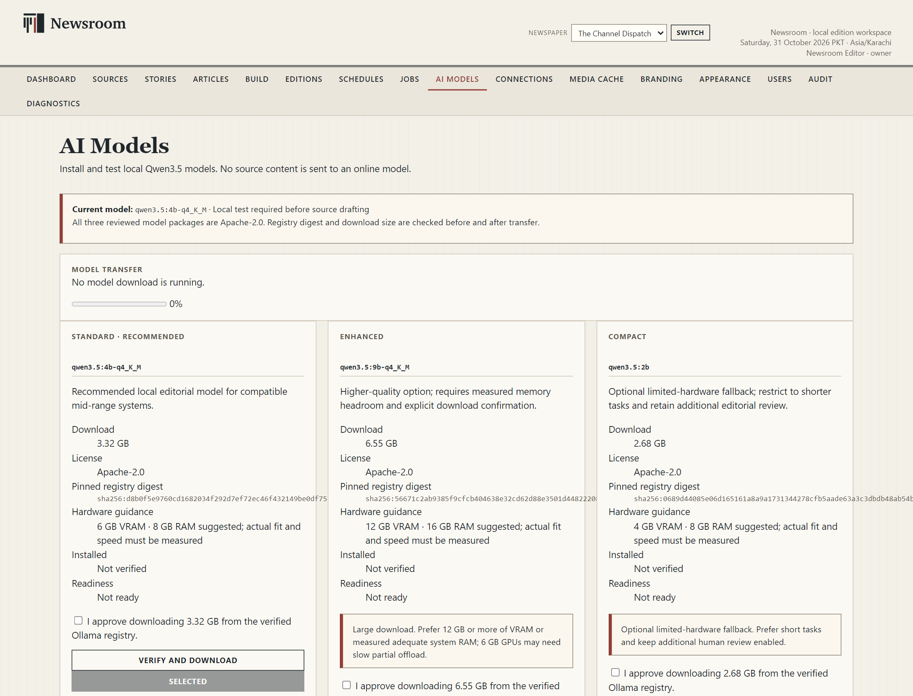

### 10.1 Profiles

| Profile | Model | Download | Suggested hardware |
|---|---|---:|---|
| **Standard · Recommended** | `qwen3.5:4b-q4_K_M` | 3.32 GB | 6 GB VRAM · 8 GB RAM |
| **Enhanced** | `qwen3.5:9b-q4_K_M` | 6.55 GB | 12 GB VRAM · 16 GB RAM |
| **Compact** | `qwen3.5:2b` | 2.68 GB | 4 GB VRAM · 8 GB RAM |

All three reviewed packages are Apache-2.0. The registry digest and download size are checked before and after transfer. Hardware guidance is a suggestion; actual fit and speed must be measured on the machine.

### 10.2 Readiness states

Each card reports **Installed** and **Readiness**. A model can be installed but **Not verified** and **Not ready** until its local test passes. The **Current model** line names the selected profile and repeats that a local test is required before source drafting.

### 10.3 Install and select

1. Tick **I approve downloading … from the verified Ollama registry** on the chosen card.
2. Choose **Verify and download**.
3. Watch **Model transfer**. A running transfer can be cancelled with **Cancel transfer**.
4. When the profile is installed, choose **Select profile**.
5. Choose **Test local model** and wait for the result.

**Success check:** the selected profile shows as current and its readiness reports that the local test passed. Until then, drafting for a real channel is not considered ready.

### 10.4 Limits

- Newsroom does not install Ollama or download model weights by itself. The local Ollama service must be installed and running.
- Models are large. They consume disk space outside the Newsroom data folder.
- A 9B model may be slow or may not fit on a 6 GB GPU. **Compact** is a reduced-capability fallback, not an automatic replacement.
- AI drafts require editorial review. The independent audit cannot prove that a sentence is true.
- On the tested installation the models were not downloaded, so model inference, download resumption and the draft test were not verified end to end.

---

## 11. Branding

**Branding & edition policy** controls the publication identity and the rules used by the layout.

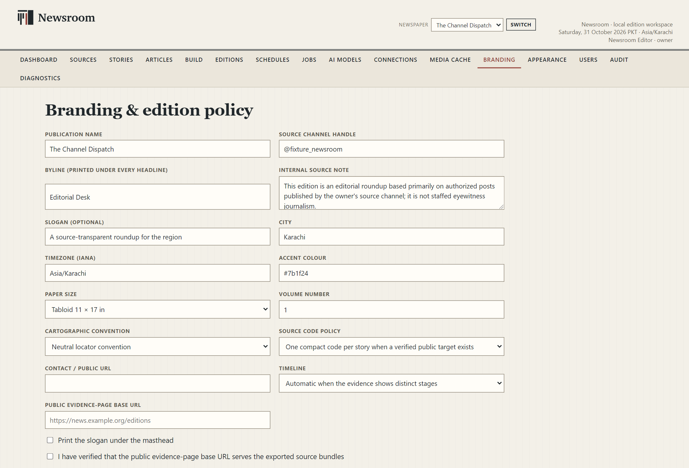

### 11.1 Publication profile

| Field | Meaning |
|---|---|
| **Publication name** | The masthead name of the newspaper. |
| **Source channel handle** | The handle shown in source notes. |
| **Byline (printed under every headline)** | The default byline. |
| **Internal source note** | A local note about the source basis. |
| **Slogan (optional)** | Printed only when **Print the slogan under the masthead** is ticked. |
| **City** | The publication city. |
| **Timezone (IANA)** | For example `Asia/Karachi`. |
| **Accent colour** | The publication accent. |
| **Paper size** | **Tabloid 11 × 17 in** or **A3 297 × 420 mm**. |
| **Volume number** | The printed volume. |
| **Cartographic convention** | **Neutral locator convention**, **Pakistan publication convention** or **Egypt publication convention**. |
| **Source code policy** | **One compact code per story when a verified public target exists**, **Verified public target only** or **No printed codes**. |
| **Contact / public URL** | The public contact address. |
| **Timeline** | **Automatic when the evidence shows distinct stages**, **Always when source times exist** or **Off**. |
| **Public evidence-page base URL** | Used only when you genuinely publish evidence pages. |
| **Print the slogan under the masthead** | Controls the slogan. |
| **I have verified that the public evidence-page base URL serves the exported source bundles** | A deliberate confirmation. Tick it only after checking the URL. |
| **Save publication profile** | Saves the profile. |

### 11.2 Automatic research

The **Research policy** can be **Off**, **Editor-triggered only**, **Automatic for substantial news** or **Automatic for all eligible stories**. The **Search provider** can be **Automatic (configured API, then publisher feeds)**, **Google Programmable Search**, **Brave Search API**, **GDELT DOC 2.0** or **Publisher RSS feeds**. **Queries per story** and **Candidate cap per story** limit the work. **Acceptance** can be **Every candidate waits for an editor** or **Accept ordinary dated context; hold contested or high-risk claims**.

Automatic providers were not exercised in this documentation. Keep the policy conservative unless you can test the provider and review its output.

### 11.3 Section order

The order list controls the sequence of sections in the paper. Sections without articles are omitted, and the front page is always first. Use the move controls to reorder. The option **Allow closing light only when a documented true source is available** is a policy guard for the closing item.

### 11.4 Newspapers on this computer

The table lists each newspaper with its slug, timezone, status and an **Open** link, plus **Deactivate** where available. **New newspaper** creates a separate publication with its own sources, schedules, drafts, editions and archive. Creating a newspaper does not copy content from another one.

### 11.5 Sources for this newspaper

A source can be enabled or disabled for the current newspaper. **Priority 1** is used first; **Weight** scales story prominence. Disabling a source keeps its archive and Telegram access but excludes it from the next build. **Save** applies the setting; **Remove** detaches the source from this newspaper.

### 11.6 Editors for this newspaper

Publication editors can work on this newspaper without access to another paper. Telegram rights and channel ownership remain separate grants. This table shows the person, newspaper role and global role.

### 11.7 Map conventions

The map convention panel names the dataset, licence and disputed-boundary rule. The neutral convention draws disputed areas with a neutral dashed outline and does not adjudicate sovereignty. The Pakistan and Egypt conventions apply the publication's cartographic convention and include a disclosure note. Choose the convention deliberately; it is an editorial decision.

---

## 12. Appearance

**Appearance** controls the printed design. The page separates colours, fonts, type metrics, section accents, a print proof and revision history.

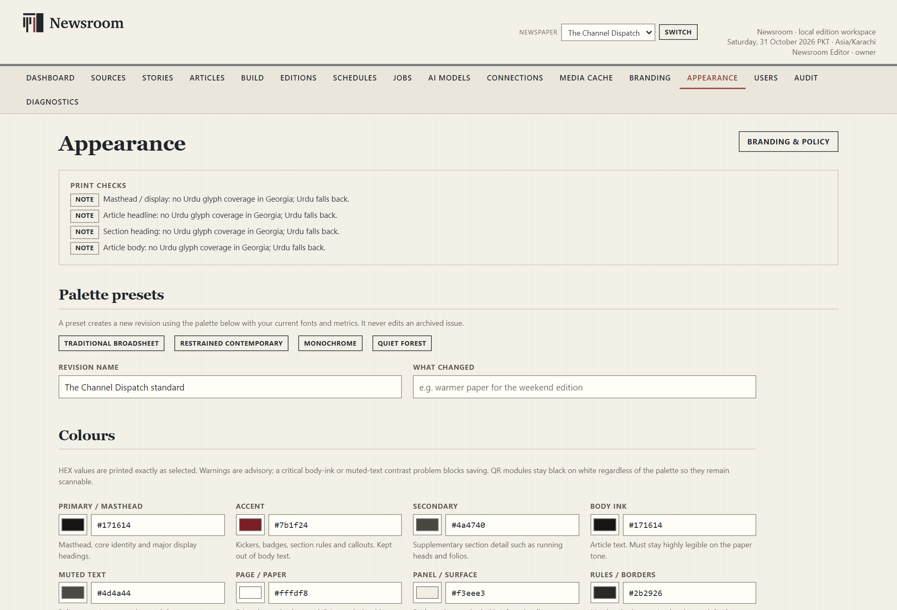

### 12.1 Print checks

The top of the page reports font coverage. For example, it can warn that a masthead or body font has no Urdu glyph coverage and that Urdu will fall back. Read these notes before approving a theme for a multilingual paper. A fallback may be acceptable, but it should be a decision rather than a surprise.

### 12.2 Palette presets

**Traditional broadsheet**, **Restrained contemporary**, **Monochrome** and **Quiet forest** create a new revision using the palette with the current fonts and metrics. A preset never edits an archived issue.

### 12.3 Colours

Each colour has a labelled role:

| Role | Used for |
|---|---|
| **Primary / masthead** | Masthead, core identity and major display headings. |
| **Accent** | Kickers, badges, section rules and callouts; kept out of body text. |
| **Secondary** | Running heads and folios. |
| **Body ink** | Article text; must stay highly legible on the paper tone. |
| **Muted text** | Bylines, captions, metadata and dates. |
| **Page / paper** | Printed page background; should stay light for print. |
| **Panel / surface** | Evidence boxes, shaded briefs and pull-quote panels. |
| **Rules / borders** | Masthead rules, section borders and dividers. |
| **Link / QR labels** | Printed citation labels and digital link text. |

HEX values are printed exactly as selected. Warnings are advisory, but a critical body-ink or muted-text contrast problem blocks saving. QR modules stay black on white regardless of the palette so they remain scannable.

### 12.4 Fonts

Only families installed on the computer or imported into the local font library are listed. A missing weight or italic face is substituted and reported instead of being faked. For each role — **Masthead / display**, **Article headline**, **Section heading**, **Article body** and the other listed roles — choose a family, weight and style.

Imported files are embedded in the PDF, the proof and the e-paper. Upload only fonts you are licensed to embed.

### 12.5 Type metrics

| Field | Allowed range |
|---|---|
| **Body size (pt)** | 8.5 to 11.5 |
| **Body leading** | 1.2 to 1.62 |
| **Headline scale** | 0.85 to 1.18 |
| **Headline tracking (em)** | -0.04 to 0.02 |
| **Masthead scale** | 0.78 to 1.12 |

The limits exist because the print layout has a minimum legibility standard. Do not force a fit by going below the allowed body size.

### 12.6 Section accents

A section accent colours that section's kicker and genre labels without changing body ink. Each configured section can have its own accent.

### 12.7 Save, proof and reset

- **Save as new theme revision** creates the next immutable revision.
- **Render print proof** renders a specimen page from the current form values with the same stylesheet and font files as the edition. It is a specimen, not a news report. Inspect it at 100% zoom.
- **Reset colours, fonts and metrics to the standard theme** returns the form to the standard values.

### 12.8 Imported font library

The table lists family, face, file, size and licence note. To import, choose a **Font file (.ttf, .otf, .ttc)**, enter a **Licence note**, tick **I am licensed to use and embed this font**, then choose **Import font**. Files are validated with fontTools and stored under a checksum. A font referenced by a saved theme revision cannot be deleted, because that would make an archived design unreproducible.

Font import and print-proof rendering were not exercised end to end for this documentation.

### 12.9 Revision history

Revisions are immutable. Saving another theme creates the next revision; nothing rewrites an edition that is already published. The table shows the revision, name, creation time, status and notes.

---

## 13. Connections and Diagnostics

### 13.1 Connections

**Connections** runs read-only checks. On the tested build the rows were:

| Service | Example result |
|---|---|
| **Internet access** | READY — an HTTPS connection succeeded. |
| **Database** | READY — `channel_press.db` readable (WAL SQLite). |
| **Free disk space** | READY — free space in the data volume against a quota target. |
| **Windows desktop runtime** | READY — WebView2 Runtime installed. |
| **Print browser** | READY — the bundled Chromium path. |
| **FFmpeg (optional)** | NEEDS ATTENTION — not installed; video stills use the OpenCV fallback. |
| **OpenCV (video stills)** | READY. |
| **Paged.js renderer** | READY. |
| **PDF inspection** | READY — PyMuPDF available for geometry QA. |
| **Font inspection** | READY — fontTools available. |
| **Telegram live adapter** | UNAVAILABLE — API id/hash not configured. |
| **Local model** | NEEDS ATTENTION — installed model still needs its local draft test. |
| **Public source list (optional)** | NEEDS ATTENTION — not configured; printed QRs stay in truthful source appendix mode. |

Choose **Check again** to refresh. The page also shows the Telegram source status and the local AI status, with links to **Open source connection**, **Import rights-cleared posts** and **Open AI models**.

A NEEDS ATTENTION row is not always a fault. FFmpeg is optional; the public source list is optional; an unconfigured Telegram adapter is expected on an import-only installation.

### 13.2 Diagnostics

**Diagnostics** repeats the counts and component table with a next action for each row, and adds a **Configuration** table:

- the environment file path;
- the Telegram session file path;
- whether the Telegram API id/hash is present;
- whether a Telegram session exists;
- the Ollama endpoint, for example `http://127.0.0.1:11434`;
- the local model and its test state;
- pending jobs.

The **Data and privacy** note explains that the database, media derivatives and published bundles stay under the local data and output folders. Credentials are optional, stored outside Git and never rendered into print output or manifests. The Telegram session file behaves like a password.

The page also contains a legacy maintenance note that names an old command-line backup tool. This manual does not use it. Use the GUI copy method in **Installation & Maintenance** instead.

### 13.3 About Newsroom

The About panel states:

> Newsroom is a local workspace for preparing and reviewing newspaper editions from authorized sources.

It also states that the publication name, masthead, themes and released editions remain independently controlled.

---

## 14. Media cache

**Media cache** shows what can be deleted and what is protected.

| Control | Meaning |
|---|---|
| **Safe-to-delete cache (dry run)** | The count and size of files that are not referenced by protected work. |
| **Clear unused media cache (safest)** | Deletes only the safe set. |
| **Clear all deletable media (including derivatives)** | Deletes the wider deletable set, including derivatives. |
| **Never deleted by these controls** | The protection list. |

The protection list includes media referenced by an active or awaiting-review edition, media under an editor lock, provenance and rights records, source post records and files whose deletion status is uncertain. Working media of a published edition is removed automatically after a successful publication; failed or unreviewed editions keep theirs for recovery.

The page also prints a legacy command-line equivalent. Ignore it for ordinary use. Media cache deletion was not exercised for this documentation; treat both clear buttons as destructive and back up the data folder first.

---

## 15. Users and account controls

### 15.1 Users

The **Users** table shows the user, role, status, last sign-in, creation time, a role-change control and access actions.

- **Save** applies a role change.
- **Disable** suspends the account.
- **Reset password** issues a new password.
- **Create a user** asks for **Username**, **Display name**, **Role** and **Temporary password**. The user must change the password after first sign-in. Passwords are hashed with Argon2id; plaintext is never stored.

Roles are **Viewer**, **Operator**, **Editor** and **Owner**. Create the minimum number of accounts needed. A shared owner account weakens the audit trail.

### 15.2 Account

The account page shows your display name, role, join date and the **Change password** form. Enter the **Current password**, **New password** and **Confirm new password**, then **Update password**.

Sessions expire after 12 hours by default. **Sign out** revokes the session on the server; clearing a browser cookie alone is not treated as a sign-out. Always sign out on a shared Windows account.

---

## 16. Audit

**Audit** shows the local trail: time, actor, action, object and detail. Typical entries include `Auth.Login`, `Source.Import`, `Edition.Media Cleanup` and `User.Create Owner`.

The detail column is machine-oriented JSON. The trail is evidence that an action happened, not a substitute for editorial notes. Use the exact time and action when reporting a problem.

---

## 17. Keyboard, window and session behaviour

- Only one Newsroom window runs at a time. Launching again focuses the existing window, including one hidden with **Continue in background**.
- Closing with the X offers **Continue in background**, **Pause safely and exit** and **Keep open**.
- **Pause safely and exit** waits for the worker and model operations to reach safe checkpoints. It can take time.
- The window is designed for a minimum of 1024 × 700; the default is 1440 × 940.
- No application-specific keyboard shortcuts were verified for this manual. Use the visible controls.

---

## 18. Where the working files are

| Item | Default location |
|---|---|
| Program files | `%LOCALAPPDATA%\Programs\Newsroom` |
| Data | `%LOCALAPPDATA%\ChannelPress` |
| Published editions | `%LOCALAPPDATA%\ChannelPress\output` |
| Logs | `%LOCALAPPDATA%\ChannelPress\logs` |

`%LOCALAPPDATA%` is usually `C:\Users\<your Windows user>\AppData\Local`. The edition workspace's **Provenance** panel shows the exact folder for a released edition. Do not edit files inside a published edition folder.

---

## 19. Quick control reference

| I want to… | Go to… |
|---|---|
| Check whether the installation is healthy | **Connections** or **Dashboard → Check connections** |
| Add a channel and record rights | **Sources → Register an authorized channel** |
| Import an authorised export | **Sources → Open channel → Import authorized content** |
| Fix a wrong post classification | **Sources → Open channel → Source posts → Apply decision** |
| Inspect evidence for a story | **Stories → Open story** |
| Edit copy and review claims | **Articles → Open article** |
| Approve or reject a review item | Article → **Review items** |
| Change an article's status | Article → **Status decision → Update status** |
| Queue a new edition | **Build → Queue build** |
| Watch or recover a build | **Jobs → Open job** |
| Release an edition | **Editions → Open edition → Release version N** |
| Correct a published edition | **Editions → Open edition → Open working version N+1** |
| Find the PDF or e-paper | **Editions → PDF / E-paper** |
| Change the masthead or paper size | **Branding** |
| Change colours, fonts or type size | **Appearance** |
| Set a cutoff and release time | **Schedules** |
| Install or test a local model | **AI Models** |
| Add a colleague | **Users → Create a user** |
| See who did what | **Audit** |
| Free disk space safely | **Media cache** (back up first) |

---

## 20. Related manuals

- **Quick Start** — install, first run and a first edition.
- **Editorial & Publishing Guide** — the editorial lifecycle, evidence, review, release and corrections.
- **Installation & Maintenance** — installation, updates, backup, restore, uninstall and privacy.
- **Troubleshooting & FAQ** — symptoms, causes and safe recovery.
- **Documentation Index** — the full document map.
