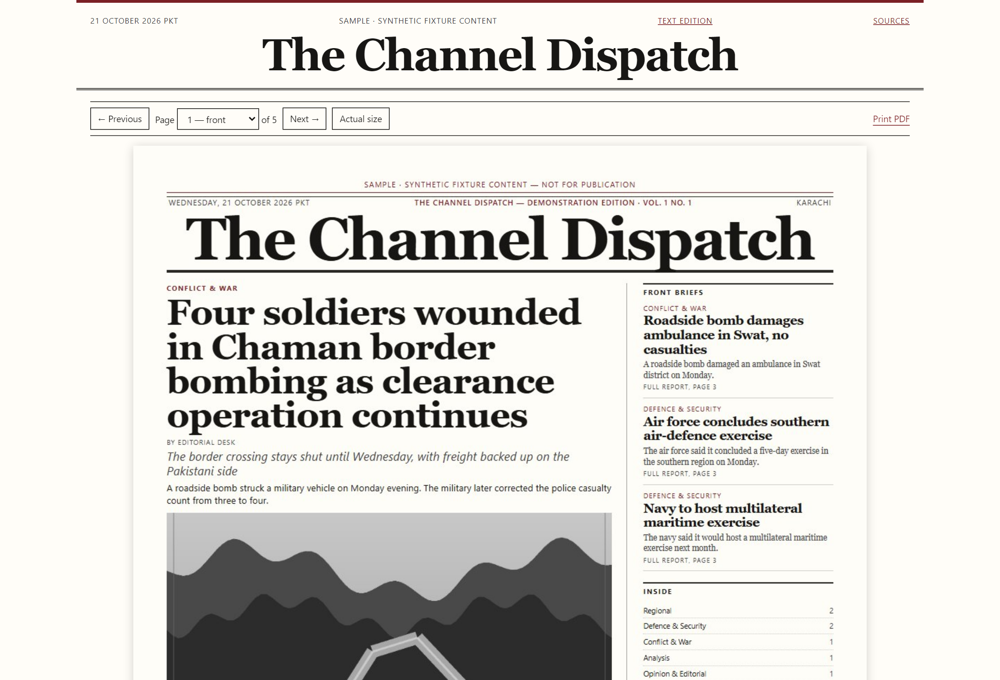
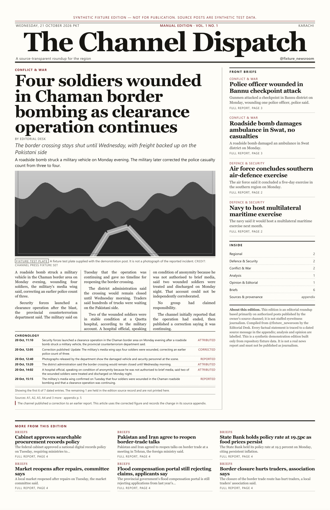

# Newsroom — Editorial & Publishing Guide

**Product:** Newsroom 1.0.0 for Windows  
**Audience:** Editors and publishers who decide what runs, what is held and what is released  
**Last verified against:** the packaged build of 31 October 2026 and a released synthetic edition

This guide is about editorial judgement and the release process, not about every control. Use the **User Manual** for a control reference. All examples in this guide come from synthetic demonstration data and are labelled as such.

> **The central rule:** a draft is not an edition, an edition is not published until it is released, and a released edition is frozen. Keep those three states separate in your own mind and in anything you tell readers.

---

## 1. The publishing lifecycle at a glance

```text
Authorised source
      ↓
Stored posts → post classification → story cluster
      ↓
Draft article → evidence audit → human edit and review
      ↓
Edition layout → preview PDF and e-paper bundle
      ↓
Release version N → frozen edition, immutable manifest
      ↓
Correction? → working version N+1 → review → release N+1
```

Each arrow is a decision point, not an automatic guarantee. Newsroom can cluster, draft and render; it cannot decide whether a story is fair, lawful or safe to publish.

### 1.1 Three different objects

| Object | What it means | What it is not |
|---|---|---|
| **Source post** | A message stored from an authorised channel or import. | A verified fact, or a licence to republish. |
| **Story** | A cluster of related posts with a claim ledger, chronology and research context. | A finished article. |
| **Article** | A drafted, editable piece with a headline, body, evidence and review state. | A published edition. |
| **Edition** | A laid-out issue with pages, a PDF and an e-paper bundle. | Published until a person releases it. |
| **Published version** | A frozen release with an immutable manifest and checksums. | A file you may edit in place. |

The application uses these words consistently. Use them consistently when you brief staff, because "published" in conversation often means "finished", while in Newsroom it means "frozen and released".

---

## 2. Before the first issue: decide the publication's rules

These decisions belong to the owner or publisher, not the layout engine. Record them before a real issue, because changing them mid-cycle creates inconsistent editions.

### 2.1 Identity and ownership

- What is the publication's legal name and masthead?
- Who is the named editor or publisher?
- Which city and timezone govern the cutoff?
- What byline appears under every headline?
- What contact address is printed?

Set these on **Branding**. Each newspaper keeps its own identity. Do not place the Newsroom name or logo in your masthead; Newsroom identifies the software, not your publication.

### 2.2 Rights and source scope

- Which channels may you republish, and on what written authority?
- Who granted the rights, and where is the evidence filed?
- Does the grant cover text, images, video stills and translation?
- What happens when a source withdraws a post or a grant?

Register each channel on **Sources** with a grantor, authority basis and evidence reference. A rights declaration is not paperwork: it is the condition that allows a live build. Revocation blocks new imports, AI processing and builds for that channel.

### 2.3 What does not become news

A channel is a stream of messages, not a news list. Newsroom excludes many items automatically, but an editor still decides the borderline cases. Do not turn the following into stories without a clear public-interest reason:

- greetings, blessings and holiday messages;
- subscription and membership promotions;
- channel cross-promotion and "join our other channel" posts;
- advertising, price lists and sponsored content;
- forwarded copies of other outlets' reporting;
- empty posts, single emoji, broken links and test messages;
- administrative notices about the channel itself;
- graphic imagery or unverified casualty claims;
- content that identifies a private person without a public-interest justification.

Newsroom's post states include **Promotion / channel call**, **Duplicate or forwarded copy**, **No content** and similar reasons. Use **Why this classification** before overriding one. If you include a promotional or administrative post deliberately, record why in the article or an editorial note.

### 2.4 Risk appetite

A high-risk story is not automatically unpublishable, and a low-risk story is not automatically safe. Define who may approve:

- casualty numbers and named victims;
- allegations against identifiable people or organisations;
- active security operations;
- medical or legal claims;
- anonymous sourcing;
- material that could inflame a communal or regional dispute.

The **Risk** column is a prompt for human judgement. It is not a legal review.

---

## 3. From source post to story

### 3.1 Collection and import

The verified route on this installation is the rights-cleared JSON import. The Telegram connection screens exist, but the tested installation had no API credentials, so live login and retrieval were not verified. Do not build an editorial process that depends on live Telegram until you have tested it on your own installation.

When you import:

1. Keep the original export file. The import records a SHA-256 and the raw, accepted and excluded counts.
2. Include referenced media where captions and credits matter.
3. Read the exclusion summary. Four exclusions out of twenty-six is normal; an unusually high exclusion rate may mean the export format or the channel changed.
4. Do not edit the source file to force an inclusion. Use the post decision controls instead, so the decision is recorded.

### 3.2 Post decisions

For each questionable post, choose:

- **Include in story processing** — the post is relevant and may contribute to a story.
- **Exclude from story processing** — the post should not be used.
- **Include as context only** — useful background, not a source of publishable claims.
- **Mark as promotional** — advertising or channel promotion.
- **Mark as channel administration** — a notice about the channel itself.
- **Mark as profanity/abuse** — abusive or unsuitable content.

Apply the decision and, where the interface offers it, record the reason. A later editor should be able to see why an unusual post was included.

### 3.3 Clustering and corrections

Newsroom clusters duplicates, albums, replies and corrections. The cluster is the story. Open it from **Stories** and read:

- the **Claim ledger** — what the draft asserts, how it is attributed and whether it is verified;
- the **Source fragments** — the original messages;
- the **Chronology** — what changed and when;
- the **Research context** — accepted external references, if any.

A correction supersedes an earlier claim without deleting it. That is the correct behaviour: the record should show both the original statement and the correction. Do not "clean up" history by deleting the earlier claim.

### 3.4 Verification states

The claim ledger uses labels such as `official_statement`, `single_source`, `unverified` and `superseded`. Treat them as editorial signals:

| State | What it means | What to do |
|---|---|---|
| `official_statement` | Attributed to an official body. | Check that the body actually said it, and whether the statement is self-serving. |
| `single_source` | One source only. | Seek corroboration or attribute clearly. |
| `unverified` | No independent confirmation. | Attribute, qualify, or hold. |
| `superseded` | A later claim replaced it. | Use the later figure and explain the correction if readers saw the earlier one. |

An official statement can still be wrong. A single source can still be right. The label describes the evidence, not the truth.

---

## 4. Drafting with AI — and without it

### 4.1 What the fixture composer does

The synthetic fixture desk uses a deterministic composer. It does not need Ollama or a model. Fixture drafts are useful for learning the workflow, but they are not evidence that a real local model works on your machine.

### 4.2 What a real local model does

For a real channel, Newsroom drafts through a local Qwen3.5 model served by Ollama. The model must be installed, selected and tested on **AI Models**. Until the local test passes, source drafting is not considered ready.

The model works from the selected source fragments and the publication's instructions. It can:

- summarise and organise source material;
- propose a headline, deck and structure;
- produce a draft in the requested genre;
- paraphrase source material. Translation may be attempted, but translation quality was not verified for this documentation.

It can also:

- omit a qualification that matters;
- merge two events incorrectly;
- invent a plausible detail;
- overstate certainty;
- reproduce source wording too closely;
- produce a fluent paragraph that is not supported by the evidence.

None of these failures is unusual. The independent audit helps, but it checks traceability and quality signals, not truth.

### 4.3 A safe drafting routine

1. Confirm the source window and the rights state.
2. Build only when the model has passed its local test, or use the fixture desk for practice.
3. Open each article and read the **Draft text** against **Source evidence**.
4. Check every number, name, place and quotation.
5. Read the **Claims** table. Resolve `unverified` and `superseded` items.
6. Rewrite anything the model has overstated. Prefer plain attribution: "the department said", "according to the statement".
7. Add context a local reader needs, but do not add facts that are not in the evidence.
8. Lock the text when it is approved so a later run cannot replace it.

> **Do not publish a model output because the audit is green.** A green audit means the draft is traceable and meets some style and length checks. It does not mean the reporting is correct.

### 4.4 When not to use AI

Use human writing, or hold the story, when:

- the story relies on a single anonymous source;
- the allegation is legally sensitive;
- the source text is ambiguous or contradictory;
- the material is in a language the model handles poorly;
- the story requires original analysis of documents;
- the publication's policy forbids model drafting for that section.

The application does not prevent you from drafting such a story. Editorial policy must.

---

## 5. Human review

### 5.1 The three questions

For every article, an editor should be able to answer:

1. **What does this piece assert?** Read the claim ledger, not only the prose.
2. **What supports each assertion?** Name the post, document or accepted reference.
3. **What could be wrong, unfair or dangerous?** Then decide whether the risk is acceptable.

If you cannot answer the first two, the article is not ready. If the third answer is "I don't know", hold it.

### 5.2 Reading the review panels

The article editor presents several independent signals:

- **Audit** — citation coverage, supported fact sentences and available claims.
- **Style lint** — stock phrases and repeated openings.
- **Independent quality pass** — length and lead construction against the genre expectation.
- **Review items** — the blocking list, with **Approve item** and **Reject item**.
- **Publication held** — the notice that release is blocked.

Approve an item only when you have made the editorial decision it asks for. Reject it only when the item is wrong for this article, and be ready to explain why. Neither button edits the copy.

### 5.3 Quality items are not all equal

A quality item that says an opinion article is shorter than expected may be a legitimate editorial choice. A quality item that says a news article is fifteen words long usually signals a drafting failure. Read the article before deciding.

Length thresholds are genre-based, not universal. A brief is meant to be short. An analysis is not. If you routinely override the same item, the publication's genre or threshold may need review.

### 5.4 Risk items

An elevated-risk story needs a named editor's decision. Check:

- whether the headline overstates the evidence;
- whether a casualty figure is current;
- whether an allegation is attributed and balanced;
- whether a named person has had a chance to respond where the story warrants it;
- whether an image identifies a private person or reveals a location;
- whether publishing could endanger a source.

Newsroom records the decision. It does not make it.

### 5.5 Status discipline

Use the article status deliberately:

- **Draft** — work in progress.
- **Needs review** — ready for an editor but not approved.
- **Needs research** — a specific gap must be filled.
- **Approved** — accepted for a clean release.
- **Held** — deliberately kept out of release.
- **Excluded** — removed from the edition.

Do not mark an article **Approved** merely to clear the release button. The release button is not the goal; a defensible edition is.

### 5.6 Locks and revision history

**Lock article** and **Lock this headline and text against regeneration** protect approved work. The revision history records each saved state. If a later change is disputed, the history shows what was saved and when.

A lock is not a substitute for a backup. Keep the data folder backed up, especially before a large edition.

---

## 6. Media selection

### 6.1 Eligibility

The article editor offers source assets from the local cache. It does not browse the internet for images. An image may be technically eligible and still unusable because:

- the rights grant does not cover images;
- the image is a test plate or a placeholder;
- the image has been altered or is undated;
- the caption would identify a private person;
- the image is too graphic for the page;
- the image does not show what the caption claims.

### 6.2 Captions and credits

Every image needs an accurate caption and credit. The caption should say what the image shows, where and when, and who took or supplied it. The credit should name the rights holder as required by the grant.

Do not use a generic caption such as "scene of the incident" for an image that shows a different location or a later moment. Do not crop out a watermark or credit.

### 6.3 Layout limits

Briefs and narrow columns do not receive a second picture. The layout may drop a supporting image to keep the page legible. If an image is essential to the story, give the story enough space and check the preview.

### 6.4 The fixture plates

The demonstration edition includes synthetic plates labelled **Fixture test plate A/B/C** and **Not documentary evidence**. They exist to test albums and layout. They must never appear in a real publication.

---

## 7. Layout and preview

### 7.1 What the layout engine decides

The layout engine places articles by section, genre and available space. It applies the publication's theme, paper size, section order and type metrics. It can produce a technically valid page that is editorially poor: a thin page, an awkward jump or a headline that loses its meaning across a column break.

### 7.2 What the editor must check

Open the preview PDF and inspect every page at a readable zoom:

- Is the front page the right lead?
- Does every headline fit without clipping?
- Are decks and standfirsts attached to the right stories?
- Are images correctly captioned and credited?
- Are page numbers, running heads and section labels correct?
- Are there blank, duplicated or underfull pages?
- Does the last page end cleanly?
- Is the QR code, if any, pointing at a real target?

The **Edition quality** panel reports page count, warnings, page fill and underfull pages. Underfull pages are reported, not treated as a proof failure. A page that is 11% full is worth a second look even if the PDF is valid.

### 7.3 Stale previews

If you change copy after rendering, the preview is stale. The workspace says so and offers **Rebuild preview only**. A stale preview must not be released. The published PDF would not match the text you approved.

### 7.4 Typography and language

Check that the chosen fonts cover the scripts in the issue. The **Appearance** page warns when a font has no Urdu glyph coverage and falls back. A fallback may render, but it can look inconsistent and may not shape the script correctly. Inspect the proof.

Do not reduce body type below the allowed minimum to force a fit. Rewrite or reflow instead.

---

## 8. Release

### 8.1 The release decision

Release is the moment a working edition becomes a published record. Before choosing **Release version N**, confirm:

- [ ] Every article is approved, held or excluded deliberately.
- [ ] Every blocking review item has a decision.
- [ ] The preview is current.
- [ ] Every page has been inspected.
- [ ] Images, captions and credits are correct.
- [ ] Names, numbers and quotations have been checked against the evidence.
- [ ] The edition name, date and volume are correct.
- [ ] The publication's legal or editorial sign-off process has been followed.

### 8.2 What release does

**Release version N** renders the latest saved revisions and freezes the version. The status becomes **Published**, an **Immutable release** badge appears, and the manifest and checksums are fixed. There is no automatic upload to a website, social network or wire service.

### 8.3 What release does not do

- It does not fact-check the issue.
- It does not obtain legal review.
- It does not grant rights you do not have.
- It does not publish to a remote audience.
- It does not prevent a later correction; it preserves the original as a version.

### 8.4 Outputs

A released edition provides:

| Output | Use |
|---|---|
| **Published PDF** | The print-ready tabloid or A3 file. |
| **E-paper** | The offline page-turner, text edition and source appendix. |
| **Open preview PDF** | The working preview, when it still exists. |

The files live under `%LOCALAPPDATA%\ChannelPress\output\<publication-slug>\<edition-folder>\`. The **Provenance** panel names the exact folder. Do not rename or edit files in a published folder.

### 8.5 Distribution

Newsroom does not upload. Distribution is a separate human step: print, copy to a shared drive, send to a printer, or hand the PDF to whoever operates the website. If you publish the e-paper online, you are responsible for the hosting, access control and any personal data in the bundle.

---

## 9. Corrections and immutable versions

### 9.1 Why versions are immutable

A published edition is a record. If the PDF could be edited in place, a reader could not tell what was originally published, and an audit trail would be meaningless. Immutability protects the publication as much as the reader.

### 9.2 Correcting a published edition

1. Open the published edition.
2. Choose **Open working version N+1**. This creates a draft from the latest saved revisions.
3. Make the correction in the article editor.
4. Record what changed and why in the revision or an editorial note.
5. Re-run the audit if the change affects a claim.
6. Resolve any new review item.
7. Rebuild the preview and inspect the affected pages.
8. Release version N+1.

Version N remains available with its original manifest. Do not delete it.

### 9.3 Correction notice

A correction should be visible to readers, not only in the archive. Add a correction line or a short notice in the article and, where the publication uses one, on the cover or in a corrections column. State what was wrong and what is now correct. Avoid quietly replacing a figure.

### 9.4 Withdrawals

If a story must be withdrawn rather than corrected, hold or exclude the article in a new working version and explain the withdrawal to readers. Do not remove the original version from the archive. If the withdrawal is legally sensitive, take advice before publishing an explanation.

### 9.5 Source withdrawals

If a source withdraws a post, Newsroom records the withdrawal and blocks the material from new processing. A previously published edition does not change. Decide whether the published story needs a correction or a note, and follow the version process if it does.

---

## 10. QR citations, source appendix and e-paper

### 10.1 Source code policy

**Branding → Source code policy** has three options:

- **One compact code per story when a verified public target exists**;
- **Verified public target only**;
- **No printed codes**.

Choose **No printed codes** if you do not operate a stable public source page. A QR code that leads to a missing or private page is worse than no code.

### 10.2 The public evidence URL

**Public evidence-page base URL** is used only when you genuinely publish evidence pages. The checkbox **I have verified that the public evidence-page base URL serves the exported source bundles** is a deliberate confirmation. Tick it only after opening the URL and checking that it works without a login.

On the tested installation the public source list was not configured, and the app reported that printed QRs stay in **truthful source appendix mode**. That is the safe default.

### 10.3 The e-paper

The e-paper bundle is self-contained. It includes page navigation, a text edition and a source appendix. Open it from the edition's **E-paper** button.



Before distributing an e-paper:

- open it on a machine that is not running Newsroom;
- check that every page loads;
- check the text edition for garbled characters;
- check the source appendix for private or irrelevant material;
- check that external links are correct;
- confirm the bundle does not contain source media you are not licensed to distribute.

### 10.4 The printed page



The PDF is a print artefact, not a web page. Check it in a PDF reader at print size and, where possible, on paper before a large run. Confirm the paper size matches the printer's stock. The tested edition was 5 pages at 792 × 1224 pt (11 × 17 in) with selectable text.

---

## 11. Editorial checklist for every issue

### Before the build

- [ ] The source has an active rights declaration.
- [ ] The cutoff window is correct and does not overlap the previous issue.
- [ ] The local model has passed its test, or the fixture desk is being used deliberately.
- [ ] The publication profile, paper size and section order are current.
- [ ] There is enough disk space for media and output.

### During review

- [ ] Every article has been read against its evidence.
- [ ] Every number, name and quotation has been checked.
- [ ] Every `unverified` or `superseded` claim has a decision.
- [ ] High-risk stories have a named approver.
- [ ] Review items are approved or rejected with a reason.
- [ ] Images, captions and credits are correct.
- [ ] The text is locked where appropriate.

### Before release

- [ ] The preview is current and every page has been inspected.
- [ ] There are no blank, clipped or duplicated pages.
- [ ] The edition name, date, volume and issue number are correct.
- [ ] The legal or editorial sign-off process is complete.
- [ ] A backup of the data folder exists.

### After release

- [ ] The **Published PDF** opens.
- [ ] The **E-paper** opens and its sources are readable.
- [ ] The files are copied to the distribution location.
- [ ] The release is recorded in the publication's own log.
- [ ] Any correction is handled as a new version, not an edit in place.

---

## 12. What this product does not do

State these limits honestly to readers and staff:

- **No cloud publishing.** Release is local. There is no built-in website, newsletter, social or wire upload.
- **No guaranteed live Telegram.** The connection UI exists, but the installer does not configure API credentials. Live login and retrieval were unverified. The rights-cleared JSON import is the verified route.
- **No bundled AI.** Ollama and model weights are separate, large downloads. Model quality and speed depend on the machine.
- **No automatic fact-checking.** The audit checks traceability and style signals. It cannot establish truth.
- **No unattended scheduler while the app is closed.** The installer does not create a Windows task. Schedules define policy and support manual run and catch-up.
- **No in-app backup button.** Back up by closing the app and copying the data folder.
- **No EPUB, HTML newsletter or email export.** The verified outputs are the PDF, page proofs and the e-paper bundle.
- **No legal review.** Editorial and legal responsibility remain with the publication.

---

## 13. Related manuals

- **Quick Start** — install and produce a first preview.
- **User Manual** — every verified screen and control.
- **Installation & Maintenance** — backup, restore and safe operation.
- **Troubleshooting & FAQ** — recovery when a build or release fails.
- **Documentation Index** — the full document map.
